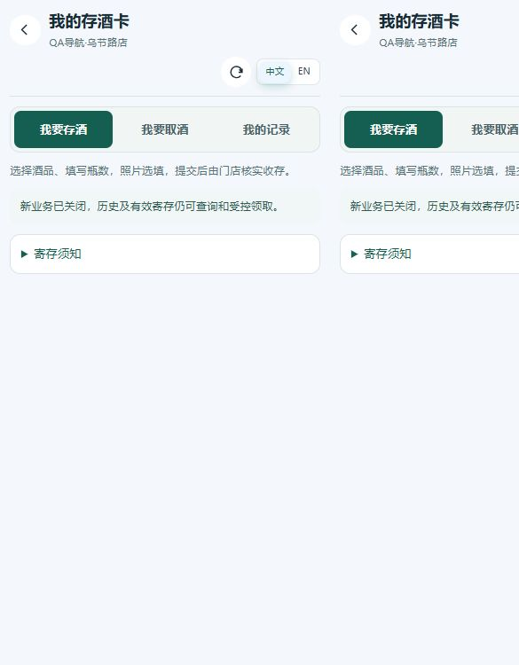

# 员工与顾客产品入口同步

2026-10-31，D:/RPB。用户授权合成数据验收、直接修复和提交部署；不改真实订阅，保留既有改动。

## 核对与实施方案

员工首页及StaffBottomNav已使用useStoreVisibleApps，每30秒和恢复可见查询/api/me/apps，权限、历史入口由AppGate决定。顾客无员工产品目录权限，使用钱包/me和酒水/home自身商业状态，不可复用员工身份接口。

发现WalletStorageSummary仅watch门店，顾客/员工钱包停留时入口不刷新；顾客酒水页仅首次及操作后加载，开通状态会陈旧。顾客钱包本身已有5秒刷新，但缺少恢复可见立即核验。后端继续逐请求控制交易和归属。

1. 提取仅负责浏览器生命周期的可见页刷新helper供相关顾客/酒水模块使用；不修改业务授权、API或数据库。
2. 酒水入口同步业务状态，关闭后仅在有已有记录时保留；切店/角色切换清空，失败清空，旧响应不覆盖当前门店。
3. 顾客钱包/酒水恢复页面立即重读，禁止后台轮询叠加请求；保留已有资金和酒水领取规则。
4. 测试覆盖轮询、focus/visibility、隐藏、卸载、请求竞态、未开通、历史及权限；使用上轮隔离合成schema和pointer运行环境，浏览器验证员工/顾客端开通、到期、停用与切店，窄屏中英验证。
5. 干净候选排除原钱包8文件及其余35份材料，审查、前端验证后按授权部署。只切前端资源，后端、环境、服务与V113不变。

具体证据、发布摘要及未验证边界完成后补录。

## 实现与审查

useVisiblePageRefresh只管理轮询、focus/pageshow/visibility及卸载释放，不处理权限或交易。酒水入口与顾客酒水页每30秒重读；顾客钱包保留5秒刷新，增加恢复页面立即校验及慢请求防重叠。门店/顾客与员工角色变化时清空酒水入口，失败关闭入口，序号隔离迟到响应。关闭但有记录的酒水入口转到现有records视图；存量领取、原单处理规则不变。顾客酒水403/404清空旧状态，卸载使旧请求失效。

浏览器另发现员工顶栏负边距导致CSS390下client368、scroll381；去掉负边距，窄屏将品牌与操作区分行，操作行可换行。仅调整已有StaffHomeTopBar，无全局布局重构。

TDD：酒水入口2项先失败（79通过/2失败），修复后通过；关闭入口进入records另先失败再修复。最终12套前端258/258，覆盖顾客轮询/focus、隐藏、卸载、慢请求、酒水启停、存量历史、角色与门店切换迟到结果。使用Node experimental-transform-types；最初直接node或strip-only不支持既有TS参数属性，属于测试启动方式错误，已用正确命令全套通过。

Code Review：scope为7个源/测试文件及MD；无API/数据库/环境/权限更改，无跨模块业务授权耦合。P0/P1无，P2无阻塞项；Final Decision：APPROVE。新helper只包含生命周期，使用者保留业务忙碌与身份守卫，未替换或绕开AppGate。

## 合成数据与后端证据

沿用上一轮隔离schema及8106/5206，仅在该克隆补充QA顾客会话、空钱包配置与一条取消的酒水申请作为历史，未配置密码或资金。私有fixture与会话不提交。

真实HTTP验证：顾客自己钱包/酒水读取200；外租户门店均404；员工会话不能替代顾客会话（401）；外租户员工目录为空。钱包自然到期后发码请求403 STORE_APP_EXPIRED；停用酒水新增申请403 STORAGE_FORBIDDEN。均未产生记录或资金写入。

49张钱包/酒水表和26张工资/补发/订阅事件表相对夹具初始化后的指纹一致。证据位于target/product-entry-staff-customer-20261031/：api-probe.json、blocked-writes.json、commerce-before/after.json、financial-final.json。

后端未变，复用上一轮同版本14项AppGate/Postgres测试及本轮真实API证据；本轮不再次跑无变化的后端全量。

## 浏览器验收结果

证据根目录同上；均为实际Chrome、真实本地后端响应，不将组件测试代替浏览器行为。

| 场景 | 证据与结果 |
| --- | --- |
| 员工开通/停用/恢复 | staff390-initial、staff390-wallet-disabled、staff390-wallet-restored；无需重载，停用只保留历史 |
| 员工自然到期 | staff390-wallet-natural-expiry；合成有效期40秒后自然失效，业务入口自动移除、历史保留 |
| 员工切店及新开通 | 通过实际门店选择器切B；staff390-storeB-history无A入口；activate-B后staff390-storeB-activated自动出现B钱包 |
| 员工权限隔离 | 该QA员工只有wallet.view/workforce.view，未因订阅生效出现酒水、管理或其他产品入口；外租户目录空 |
| 顾客到期/恢复 | customer390-expired-wallet-wine-history无付款码/扫码，保留交易及已有酒水历史；恢复后customer390-automatically-activated自动出现业务入口 |
| 顾客酒水自然到期 | customer390-wine-active→customer390-wine-natural-expiry，未重载或点击刷新；存酒表单消失，历史/受控领取提示保留 |
| 顾客历史 | 实际点击我的记录，原取消申请可读（customer390-history-record）；钱包酒水快捷入口自动切为view=records（customer390-expired-wine-shortcut） |
| 顾客切店 | 通过门店独立钱包网址进入B，非新增门店选择器；customer390-storeB-no-history无A链接、关闭且无历史的酒水隐藏 |
| 顾客新开通/停用 | B酒水重新启用后自动出现；B钱包停用后5秒刷新移除付款码/扫码，酒水独立可用（customer390-storeB-wallet-disabled） |
| 顾客只读交易历史 | 实际点击钱包底部交易记录，customer390-disabled-wallet-transactions成功打开，0条合成交易，无写操作 |
| 最终窄屏布局 | staff390-final-layout实际CSS390、client=scroll=390；staff320-en-final-layout-direct实际CSS319、client=scroll=319；顾客CSS390无横向溢出 |

员工业务/历史目录每30秒核验；顾客钱包保留5秒核验，酒水每30秒核验。返回可见立即重读及隐藏页/卸载/并发控制由组件行为测试覆盖，本轮没有逐一做浏览器focus/visibility场景。

顾客不存在跨产品员工权限目录，不向顾客调用/api/me/apps。卡权益、充值申请入口保留以便读取原记录；既有新交易限制和原单处理规则未重写。本轮针对入口和状态同步，不宣称预约填写、付款、售卡、存取酒等全部业务表单端到端通过。

## 发布准备与剩余风险

Production Readiness：GO。最终源前端258/258（frontend-final5.log），干净候选类型检查与Vite通过（types-final3、vite-final3）。索引SHA256 a5e47d9f44b2508d515c54c6a63ab23c53c2e123cea8452902c1c20502874a0a。7份相关源/测试固定哈希，35份原有排除材料未变。

UI Review：窄屏员工顶栏溢出已按最终DOM几何复验消除，顾客历史可读。浏览器截图接口后半程多次超时；尝试原生窗口截图时，工具自动安全检查因无法可靠判定Windows当前网址而中止Computer Use，之后停止一切界面操作。最终员工窄屏只有DOM尺寸/链接证据，未补存修复后截图；文件名带staff320但内容实际390的中间证据不计入319验收，只使用direct文件的实际宽度。未做实体手机、微信或真实资金验收，不宣称最终截图视觉通过。

Release Notes：修复酒水入口及顾客页停留状态陈旧、只读快捷入口目标、员工窄屏顶栏溢出；无迁移、API、环境或权限新增，原单与领取规则不变。回退只恢复本次前端备份index和FRONTEND_RELEASE_SHA，保留不可变资产；不回滚数据库或后端。发布前要求线上前端e8fcedd6、后端d23a94f4、V113及既有索引摘要，发布后仅前端版本变化。

## 生产发布结果

- 提交/前端发布474c72a43b0ded31b04a91b1e0bd38035f25d7d1，已推送codex/paynow-payment-product-line-staging。7个源/测试与干净候选一致（仅Git换行归一化）；原钱包8文件未混入。
- 419份前端文件服务端逐一核验，仅原子更新index及FRONTEND_RELEASE_SHA，保留旧资产。归档SHA256：5744b5771d1be3c9810f56960f536a662e2f28dd208b2405b207dc345fcaf1b9；索引摘要同上。
- 后端仍d23a94f4，JAR SHA256 37e4a5676eca343b65308dc902e8d4ca1bb5b37ca3864ca5b276cfac92eabc56。环境及所有服务状态、PID、InvocationID前后一致；后端PID3626821、NRestarts0。数据库113|113|0，无订阅/数据库写入，无服务重启。
- 公网7个页面返回本次index，19份受影响JS/CSS哈希一致，包含员工顶栏CSS、顾客钱包、酒水页面、共享刷新helper；匿名管理员接口401、匿名产品目录为空。由于上述浏览器安全检查中止，发布后未再进行登录浏览器操作，不把公网资源核验称为线上交互验收。
- 回退集：/opt/rpb/backups/20261031-product-entry-staff-customer-474c72a4-before；阶段制品：/opt/rpb/releases/20261031-product-entry-staff-customer-474c72a4。未触发回退。回退仅旧index/前端标记，无后端或数据库回滚。
- 本地证据：committed-source-proof.json、verification-final.json、artifacts.json、deploy-result.json、public-result.json及浏览器DOM/几何/截图。最终49张商业表、26张工资/事件表指纹与初始化后相同；35份排除材料哈希不变。
- 已打开页面刷新一次加载新JS后自动同步；到期写请求由后端即时拒绝，不等待前端轮询。真实订阅、付款、钱包金额及历史工资未修改。
