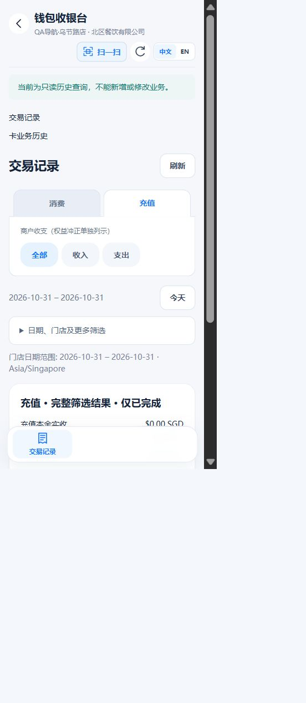
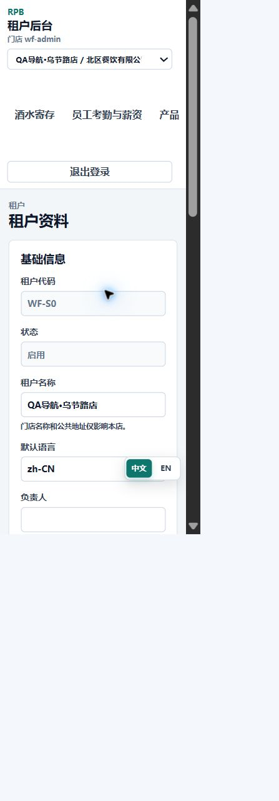

# 产品线导航浏览器验收与历史只读修复

2026-10-31，D:/RPB。用户明确授权修复、提交、推送与部署。仅发布前端，不修改真实订阅。

## 环境与验收

严格读取target/local-postgres-current.txt：61644/postgres、postgres空密码。复用合成数据，克隆至workforce_browser_15e08b99be3c43ef91fb2587a3304b40，独立后端8106、回环代理5206，后端d23a94f4/V113，无迁移。原验收schema保留。QA会话仅在target私有fixture，不提交。

证据根目录：target/product-navigation-browser-20261031/。Chrome实际CSS宽度319/390及桌面1440/1920，中文、英文均无整页横向溢出。

| 场景 | 实际结果与证据前缀 |
| --- | --- |
| 合成新增酒水开通 | 无需重载，轮询后出现；desktop-before-activation、narrow390-after-activation |
| 手动停用钱包 | 业务入口消失，历史保留；narrow320-after-wallet-disabled |
| 日账自然到期 | 合成订阅设40秒后自然到期；自动移除业务入口、保留历史；narrow320-after-natural-expiry |
| 历史读写 | 浏览器打开只读日账；GET200，有写权限账号PUT403 STORE_APP_EXPIRED；narrow320-readonly-ledger、browser/api-check.json |
| 恢复有效 | 日账自动恢复；手动停用的钱包仍保持关闭；desktop1440-after-reactivation |
| 切店与竞态 | B仅B入口；A延迟1800ms，B→A→B后无A链接；narrow320-storeB、narrow320-after-late-storeA-response、代理日志 |
| 权限隔离 | 受限管理员只见workforce，直接酒水页拒绝；未授权同租户/外租户目录均空；narrow320-limited-manager、narrow320-direct-product-denied、browser/api-check.json |
| 显式历史模式 | 钱包重新启用后，底部交易、今天、充值筛选仍保留history=1；中性只读提示；final-wallet-narrow390-direct，CSS390、client=scroll=368 |
| 线上只读查看 | 用户指定资料页导航可见，CSS391、client=scroll=372；无订阅/开关修改；live-navigation-readonly、live-narrow390-readonly |

开通02:00:53Z，下一次apps请求02:01:13Z；不声称精确首次DOM更新时间。后台隐藏/恢复、失败清空由组件测试覆盖，本轮未逐一做浏览器离开/恢复动作。启动未就绪及首次合成外租户缺少格式必填值的事务失败已修正，属于夹具问题。

## 修复与模块边界

浏览器复现钱包历史底部入口与筛选丢失history=1（wallet-history-marker-red、wallet-history-filter-red）。复用WalletBottomNav及transactions/query保留入口、筛选、详情的只读标记；WalletPointsReversalAction在显式只读时隐藏冲正动作。产品恢复开通后旧提示误报关闭，改中英文中性只读说明，保留翻译键及租户覆盖。

history仅是前端视图标记，transactionSearch不将其传后端，不承担权限授权。普通员工/顾客路径不变；AppGate继续逐请求校验。无API、数据库、后端、权限、环境或金额规则变化。

## 验证及限制

- 新增回归先失败再通过；最终11套前端173/173，无失败/跳过（frontend-final2.log/exit）。
- 干净候选基于5dfd9c53，仅叠加7个相关源/测试文件；vue-tsc、Vite exit0，418份制品。index SHA256：1b1fabc7151d294d7ee85de931852417caaf552bd4c95d982c05d2a82be474b2。
- 后端未改，复用上一轮同版本Postgres10项和MeApps4项；本轮额外7次真实HTTP验证。26张工资/补发/订阅事件表最终指纹一致（browser/financial-final.json）。
- 原钱包8文件及其余35份排除材料哈希不变，未混入候选。真实订阅、工资、付款、钱包金额未修改。
- 合成交易列表为空：详情行与积分冲正仅组件测试覆盖，未声称浏览器点击非空详情或真实资金操作。窄屏为桌面响应式验收，未做实体手机、触摸、微信验收。

## Code Review Report

Scope：7个前端源/测试文件和MD。P0/P1：无。P2：无阻塞项。检查作用域、响应式查询、正常/顾客路由、后端不透传视图标记、权限、AppGate及详情返回地址。Test Coverage：173项及浏览器/API证据。Final Decision：APPROVE。

## Release Notes / Production Readiness Report

New：浏览器和窄屏证据。Fixed：钱包只读标记、动作及提示。Migration：无。Permission：无新增或扩大。预约/排队/清洁等业务不变。

Checklist：测试、类型、构建通过，候选排除无关改动，服务回环绑定，无新增接口/迁移/环境/权限，沿用审计及错误码。Blocking Issues：无。Non-blocking Issues：上述实机和空列表边界。Rollback Plan：仅恢复本次备份index与FRONTEND_RELEASE_SHA，保留不可变资产，不回滚数据库/后端。Decision：GO。

发布前核实backend=d23a94f4、frontend=61b0a890、V113及JAR/环境/服务摘要；发布后只允许前端版本变化，不重启后端。生产结果完成后补录。

## 生产发布结果

- 功能提交及前端发布：e8fcedd6f856371e9dfaaa940d645fd74490ad80，已推送codex/paynow-payment-product-line-staging。7份源/测试与干净候选逐字对应（仅Git换行归一化），未包含钱包原有8文件。
- 418份前端文件在服务端逐一核验，只原子切换index及FRONTEND_RELEASE_SHA；旧不可变资源保留。归档SHA256：19cf984be0ad44672da4990cb239a610f996aae19b8ecc830bcdf5b8f1754bc3；索引摘要同上。
- 后端d23a94f4、JAR摘要37e4a5676eca343b65308dc902e8d4ca1bb5b37ca3864ca5b276cfac92eabc56、环境摘要、全部服务状态/进程/InvocationID均前后一致。后端PID3626821、NRestarts0；数据库迁移仍113|113|0，无数据库写入或重启。
- 公网5个页面返回本次索引，13份相关JS/CSS哈希一致；匿名管理员资料/产品设置接口401，匿名产品目录为空。部署后浏览器只读确认线上资料页钱包、酒水、日账、员工考勤与薪资等入口可见；未操作真实订阅或开关。
- 回退集：/opt/rpb/backups/20261031-product-navigation-browser-e8fcedd6-before；阶段制品：/opt/rpb/releases/20261031-product-navigation-browser-e8fcedd6。未触发回退。
- 证据：target/product-navigation-browser-20261031/下committed-source-proof.json、verification-final.json、deploy-result.json、public-result.json、live-after-deploy.json。最终35份排除材料哈希未变。
- 已打开旧页面需刷新一次取得新JS，之后可见页每30秒核验，恢复页面立即核验；后端到期拦截不等待轮询。实体手机、微信与真实订阅切换仍未实操。

