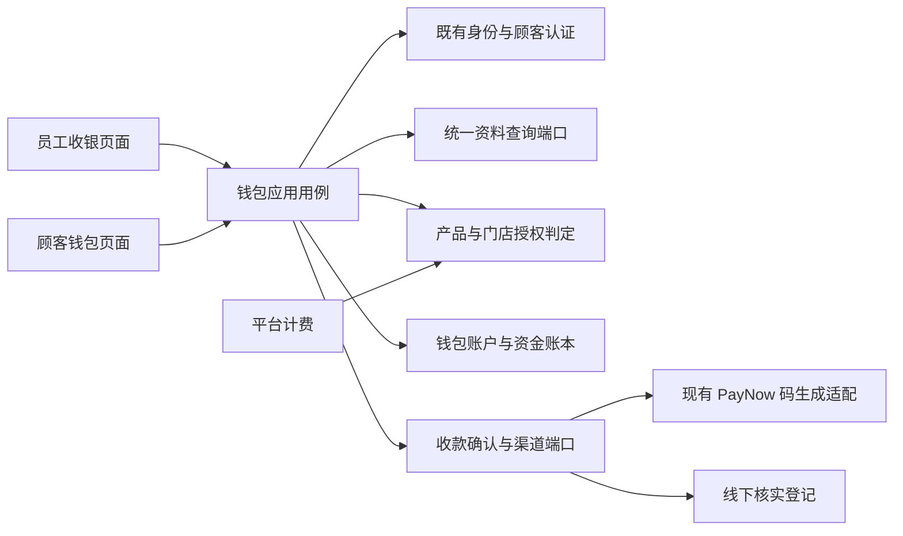

# 钱包产品线开发需求与模块化设计

日期：22-10-2026。项目：`D:\RPB`。文档版本：1.0。

状态：**需求规格，待开发；本次仅新增本文档，不修改业务代码、数据库、依赖或运行配置，不提交部署。**

依据：用户已讨论的钱包方案，以及补充要求“充值可选现金、PayNow、信用卡，暂不对接线上支付，将来开通”。现状核对基线为 `774e10667e19a8194d6db0d29238695d96109d0e`；既有代码实现提交为 `8a4565718040c606516c22817ac5779d52e7ac28`。本文描述目标行为，不代表钱包、渠道接口或计费增强已经实现。

## 1. 产品定位与关键决定

1. 新增独立产品线 **储值钱包**，稳定标识建议为 `wallet`；沿用现有 RPB 单体架构，独立划分领域模块，不新建系统、登录体系或数据库。
2. 钱包管理顾客预存本金、消费扣款、退款冲正与资金流水；现有 PayNow `payment` 负责可复用的收款码、参考号和收款能力。不得把钱包业务直接堆进 `PaymentIntentService` 或租户管理控制器。
3. 第一版充值方式为 **现金、PayNow、信用卡**。三种方式均为线下收款、员工核实后登记确认；信用卡由现有刷卡机/POS 收款。**不接银行/支付网关、线上信用卡收单、自动扣款或自动到账回调。**
4. PayNow 可展示现有配置生成的收款二维码，但生成码、顾客点“已付款”、付款截图或 OCR 匹配，均不能直接增加钱包余额。
5. 支持员工输入消费金额扣钱包、员工扫顾客付款码、顾客扫商户账单码付款。第一版扣钱包均需顾客确认商户、金额及钱包扣款金额。
6. 余额不足时允许扣完可用余额，明确显示未付差额，账单保持部分支付；差额可用现金、PayNow 或信用卡线下补付并由员工确认。
7. 统一复用平台租户、经营主体、门店、员工及租户级顾客身份。余额按钱包发行经营主体归属，仅在同一钱包计划授权门店使用，不跨租户通用。
8. 复用平台产品目录、价格、订阅、按店计费明细、授权和 App Gate。软件订阅费与顾客钱包充值资金必须分账、分单、分报表。
9. 首版不包含赠送金、积分兑换、余额过期、顾客间转账、自助提现、跨经营主体清算、完整 POS 商品订单或税票引擎。

## 2. 现有代码审计与复用边界

以下路径相对于仓库根目录；历史文档中的旧限制不得直接当作当前实现结论。

| 范围 | 当前证据 | 复用与改造要求 |
|---|---|---|
| PayNow 支付来源 | `payment/application/PaymentIntentService.java` 只接受 `quick_pay`、`generic_merchant`，现有创建入口以员工身份执行 | 增加窄的来源适配契约，不能直接把员工快速收款接口暴露给顾客 |
| 收款基础 | `payment/provider/PayNowQrPayloadBuilder.java`；`payment/application/PaymentMethodProfileService.java` | 复用收款资料、金额/参考号二维码生成；现金和信用卡不伪装成 PayNow 订单 |
| 截图确认 | `payment/application/PaymentProofReviewService.java` 中参考号和金额匹配可自动确认；`payment/persistence/JdbcPaymentProofReviewRepository.java` 将支付状态改为 `paid` | 钱包不得订阅笼统的 `paid` 状态就加钱；必须核验收款来源和可信确认级别，OCR 仅辅助 |
| 人工确认 | `payment/application/PaymentIntentService.java` 与 `payment/persistence/JdbcPaymentIntentRepository.java` | 可借鉴操作审计、作用域、幂等；现有 quick-pay 确认不能直接充当钱包充值确认 |
| 顾客与顾客认证 | `customer/domain/Customer.java`；`customerauth/application/CustomerAuthApplicationService.java` | 复用同租户 `customer_id` 和既有顾客会话，不复制会员库 |
| 统一资料 | `tenantadmin/persistence/TenantAdminProfileRepository.java` | 按既有归属读取租户 Logo、经营主体及门店资料 |
| 平台计费 | `platformbilling/application/ProductSubscriptionService.java`；`SubscriptionQuoteService.java` | 复用现有生命周期；新增钱包按选择门店开通时，须补足现有整体命令默认取全部有效门店的限制 |
| 产品入口 | `src/main/resources/product-line-entries.json`；`appgate/application/AppGateService.java` | 注册受控入口、权限和商业有效期检查；目录登记本身不等于产品上线 |

表中 Java 路径前缀为 `src/main/java/com/rpb/reservation/`。本轮静态核对未发现已实现的钱包账本或 payment 模块内的银行到账回调；不得宣称已有这些能力。

参考现有规范：[新增产品线通用需求](新增产品线开发需求.md)、[产品落地手册](PRODUCT_LINE_IMPLEMENTATION_PLAYBOOK.md)、[架构约定](../architecture/ARCHITECTURE.md)、[当前产品访问契约](../api/2026-10-22-product-line-access-contract.md)。

## 3. 角色、首版范围与线下支付边界

| 角色 | 主要职责 |
|---|---|
| 平台管理员 | 钱包目录、价格、租户购买/续费/暂停/取消、门店商业授权；不默认获得顾客余额操作权 |
| 租户管理员 | 钱包经营主体及门店配置、角色分配、对账、例外和退款管理 |
| 门店经理/授权审核人 | 线下收款确认、退款及异常复核；仅在授权门店范围内操作 |
| 收银员工 | 建充值单、建消费账单、扫码发起收款、查看当前交易结果；确认收款需另有相应权限 |
| 顾客 | 登录既有顾客账号，查看本人钱包与流水、展示付款码、确认钱包消费 |

三种充值方式必须分别记录，不允许自由文本替代渠道代码：

| 渠道 | 首版收款方式 | 入账前必须确认 | 本期边界 |
|---|---|---|---|
| `cash` 现金 | 员工实际收取现金 | 实收金额、收银员、终端、收款时间；找零后净收款等于充值金额 | 可由具备现金确认权限的收银员立即确认，不要求银行凭证 |
| `paynow` | 顾客通过自己的银行 App 向商户转账；可使用收款码 | 商户银行端真实入账、收款账户、金额、交易参考/可核对的银行流水标识 | 员工人工核实；截图/OCR 不作到账事实 |
| `credit_card` 信用卡 | 外部刷卡机/POS 完成交易 | 终端交易已批准、金额、终端号、交易/小票参考号 | RPB 只登记外部结果，不采集卡号、有效期、CVV 或代扣凭据；刷卡批准不冒充银行最终结算 |

第一版一张充值单只对应一种渠道和一个确定金额；需拆分充值时建立不同充值单。失败或待确认交易不得记作已充值。支持配置门店允许的渠道；未配置 PayNow 不影响现金/信用卡充值。

## 4. 统一资料复用与资金归属

### 4.1 权威来源

| 数据 | 权威来源/归属 | 钱包规则 |
|---|---|---|
| 租户 ID、编码、生命周期 | 平台租户管理 | 引用既有租户；开通钱包不创建第二个租户 |
| 经营主体 | 现有 `operating_entities` | 每个钱包计划绑定一个发行经营主体，校验同租户关系 |
| 门店名称、地址、电话、时区、语言 | 统一门店资料 | 读取当前资料，钱包设置不再维护一套 |
| 品牌 Logo | 租户公共媒体引用 | 更换/清除后钱包同步读取新状态，不回退旧产品私有 Logo |
| 员工、角色、门店访问权 | 既有身份与 RBAC | 同账号切换产品，不另建钱包员工登录 |
| 顾客姓名、联系方式、身份 | 既有租户级 Customer 与 Customer Auth | 钱包只引用 `customer_id`，不以电话/邮箱复制一张钱包客户表 |
| 钱包业务资料 | 钱包模块 | 账户、余额、流水、充值、消费授权、退款、业务策略 |
| 产品价格与订阅 | 平台计费模块 | 钱包只读取授权结果，不自行维护收费状态 |

历史交易允许保留注明时间/来源的商户名称等凭证快照；这些快照不能成为当前资料来源，更不能反写公共资料。

### 4.2 钱包账户与可用门店

- 第一版一个经营主体最多启用一个 SGD 钱包计划；账户唯一范围为 `(tenant_id, program_id, customer_id, currency)`，重复开户返回同一账户，初始余额为零。
- 顾客身份为同租户共享；可在同一发行主体的多个有效授权门店消费。同一顾客在不同发行主体下使用不同钱包账户。
- 充值门店和消费门店可不同，但均须属于计划的发行主体且获该计划授权。不得因同租户就跨经营主体扣钱。
- 门店变更经营主体、移出计划时禁止把旧主体余额自动迁入新主体；有在途交易时先完成处理并保留历史作用域。
- 匿名或未完成既有顾客认证绑定的临时客户不得直接获得可消费钱包；员工不能凭一个手机号绕过顾客身份确认。
- 现有顾客合并/停用/删除流程必须纳入钱包检查：禁止丢失余额、断开流水归属或简单改 `customer_id` 合并余额。首版有钱包关联时拒绝自动合并/硬删除并给出明确原因；后续专项支持可审计迁移。
- 不建立平台统一资金池；线下资金由对应发行经营主体实际收取。第一版不支持将不同租户的收款资料绑定成可互相消费的钱包。

## 5. 模块化设计与依赖约束

### 5.1 职责划分

| 模块/子域 | 拥有的职责 | 不拥有的职责 |
|---|---|---|
| `wallet.account` | 钱包计划、账户、状态、可用余额、授权门店规则 | 顾客档案、订阅价格 |
| `wallet.ledger` | 不可覆盖的资金分录、原交易关联、冲正、余额一致性 | 银行核验、页面交互 |
| `wallet.topup` | 充值单、渠道选择、确认条件、确认后入账 | 生成另一套收款二维码或信用卡网关 |
| `wallet.checkout` | 轻量消费账单、钱包支付分摊、差额和结清状态 | 商品、库存、完整 POS 订单 |
| `wallet.authorization` | 动态付款码、顾客确认、一次性消费授权 | 员工账号、顾客密码认证 |
| `wallet.refund` | 原单退款/冲正限额、审批和状态 | 直接修改历史分录、任意调余额 |
| `payment` 收款适配 | PayNow 资料/码、线下收款确认事实及未来渠道适配边界 | 钱包余额、顾客身份、平台订阅 |
| 公共资料/身份 | 统一租户、经营主体、门店、员工、顾客和认证 | 钱包资金账本 |
| `platformbilling` / `appgate` | 产品、报价、订阅、商业授权与访问判定 | 钱包充值和消费金额 |

子域是同一钱包模块内的职责边界，不要求拆成微服务或多个 Maven 模块。类和文件按真实用例拆分，不为每个数据字段创建服务，也不把所有用例堆进一个 `WalletService`。

### 5.2 工程组织与调用规则

- 后端新增 `com.rpb.reservation.wallet`，沿用 `api / application / domain / persistence`，按上述用例组织；渠道和公共资料通过窄接口及适配器访问。
- 前端新增 `src/modules/wallet`，区分顾客钱包、员工收银、管理配置和查询；公共资料组件、会话及门店上下文继续复用。
- Controller 仅做认证、DTO 校验、调用和错误映射；应用服务编排用例/事务；领域对象维护金额、状态和归属不变量；Repository 负责作用域持久化。
- 钱包不直接读写其他模块私有表；不跨模块调用 Controller；PayNow provider 不依赖钱包实体、HTTP 或 App Gate。
- 钱包与 payment 通过明确来源关联，预留 `wallet_topup`、`wallet_bill_remainder` 及稳定业务 ID。来源由服务端用例决定，不能由顾客提交任意 `sourceType` 获得权限。
- 线下确认至少提供渠道、金额、币种、实际收款主体/门店、外部交易标识、确认方式、确认人/时间及原业务来源。钱包只消费绑定自己业务单据的有效确认事实。
- 不把现金/信用卡硬塞进现有只接受 PayNow 的快速收款命令。抽取/新增最小收款确认端口，保持现有 quick-pay API 及行为兼容。
- 异步通知、导出或未来回调必须经过应用服务；不能绕开账本规则直接更新余额。

建议的依赖关系：



## 6. 核心模型与数据完整性要求

以下为模型职责，不是已批准的建表 SQL；开发时须补数据库设计、迁移和完整 API 契约。

| 模型 | 必须表达的信息与约束 |
|---|---|
| 钱包计划 `WalletProgram` | 租户、发行经营主体、币种、业务状态、授权门店、版本；业务开关不能代替商业授权 |
| 钱包账户 `WalletAccount` | 租户、计划、顾客、账面余额、受限/退款冻结额、可用余额、状态、并发版本；不保存第二套顾客资料 |
| 钱包分录 `WalletEntry` | 唯一交易 ID、账户内序号、入/出方向、金额、前后余额、原业务单/原分录、操作人、发生门店、UTC 时间；只追加 |
| 充值单 `WalletTopup` | 顾客账户、受理门店、金额、渠道、收款核验事实、入账状态、幂等摘要、版本 |
| 收款确认 `CollectionConfirmation` | 来源类型/ID、渠道、收款对象、金额、可信级别、外部凭证标识、核实人和时间；同一外部交易不能核销两单 |
| 消费账单 `WalletBill` | 账单金额、顾客/计划、门店、结算状态、钱包及外部支付分摊、剩余应付、版本 |
| 消费授权 `SpendAuthorization` | 顾客、目标账单、门店、确定扣款金额、确认时的账户/账单版本、期限、使用状态；只能成功使用一次 |
| 退款单 `WalletRefund` | 原交易、各渠道可退/已退金额、原因、审批人、外部退款证据、退款状态和冲正分录 |
| 操作审计/幂等记录 | 租户、门店、动作、操作者、业务目标、请求摘要、原响应及关联 ID；不可只记日志文本 |

资金约束：

- 第一版币种固定 SGD，金额精确到分；API 使用十进制定点表示，数据库使用定点数或整数分，禁止浮点数。超过两位小数直接拒绝，不静默舍入。
- 充值金额、消费账单金额均大于零；禁止负金额“充值”或“消费”冒充退款。
- 账面余额和可用余额不得小于零；可用余额为账面余额减去合法受限金额。没有冻结业务时两者相同。
- 可用余额、分录、支付分摊和账单状态必须在明确事务中一致提交；失败全部回滚，不出现“余额已扣但账单未知”。
- 同一充值成功事实只产生一笔充值入账；同一消费授权只产生一笔成功扣款。唯一约束与应用幂等共同兜底。
- 数据库使用租户与账户/计划/门店/顾客的适当复合约束，拒绝跨租户、跨发行主体引用；查询和后台任务同样显式限定作用域。
- 成功分录不改金额、不删除。错误通过引用原交易的补偿分录处理，余额缓存可重算并与分录核对。
- 当前余额、充值本金总额、累计消费和外部实收是不同指标，禁止用其中一个字段替代其他指标。

## 7. 充值与线下到账确认

### 7.1 正常流程

1. 员工进入有效授权门店，选择已有已认证顾客，确认钱包发行主体。
2. 输入充值金额，选择现金、PayNow 或信用卡，服务端创建 `pending_collection` 充值单。
3. 线下收款：现金实际收取；PayNow 银行转账；信用卡通过外部终端完成交易。选择渠道本身不改余额。
4. 有对应权限的员工核实实收，提交金额、凭证及确认信息。界面明确提示“确认后将增加顾客可消费余额”。
5. 服务端核对充值单、渠道、收款主体、金额与幂等，持久化可信线下确认，完成钱包入账并生成收据。
6. 顾客与员工查询同一交易结果。页面超时先查原单状态，不通过新建充值单重试原笔确认。

### 7.2 状态与异常

- 充值单状态至少包括 `pending_collection`、`verified_pending_credit`、`credited`、`cancelled`、`exception`；退款另用关联退款单表达，不覆盖原入账事实。
- 收款事实与钱包入账状态分开。若确认事实已落库而入账失败，显示“已确认收款，待入账”，以同一确认 ID 安全重试，不能要求顾客再付款。
- 员工确认和钱包入账如可在同库事务内完成，应保持原子性；外部事实独立落库时必须具有持久化待处理状态与可重试处理，不靠进程内事件防丢。
- 已收款充值不能直接取消删除；未核实实收的待收款单可以取消。取消/超时后发现实际收款转入例外处理，不静默丢弃或重复入账。
- 金额不足、超付、错误币种、错误收款主体均不自动凑单入账。首版转经理核实，更正待确认订单或按原收款退款，保留全程记录。
- PayNow 银行流水标识及信用卡外部交易参考在所属收款账户/终端命名空间内去重；人工发现同笔收款重复提交时拒绝，不能只按充值单 ID 去重。
- 现金以内部收款单/收据标识去重并进入收银交班；不能用“现金没有外部交易号”为理由取消幂等和审计。
- 信用卡后续撤销、拒付或清算异常进入独立风险/对账处理；不自动把已消费账户改成负数，不把“终端已批准”显示成“银行最终结算完成”。

### 7.3 未来线上支付扩展

本期只保留渠道确认端口及确认来源字段，不建设不可用的网关管理界面或假回调。

未来开通线上支付时另行增加 provider 适配、配置授权、签名核验、回调重放防护、收款账户校验、外部交易唯一性、超时/迟到通知、主动查询与对账。线上确认和线下人工确认共用钱包入账用例及唯一约束，不能各自增加一次余额。未实现并单独启用前，线上支付入口不展示、不接受请求。

## 8. 消费、扫码与不足额补付

### 8.1 统一消费结算规则

员工输入消费金额或创建账单后，由服务端计算：

```text
钱包拟扣金额 = min(账户当前可用余额, 账单当前未付金额)
本次钱包扣款后仍应付 = 账单当前未付金额 - 钱包拟扣金额
账单剩余应付 = 原账单金额 - 累计已确认支付分摊（退款单独记录）
```

- 第一版默认尽量使用钱包，顾客确认后最多扣完可用余额；零余额时不产生零金额扣款分录，显示全额仍需支付。
- 顾客必须看到商户、门店、账单金额、钱包本次扣款与剩余应付，并明确确认钱包扣款。员工输入金额、查到顾客或扫到码均不是最终授权。
- 确认后原子提交扣款、分录、支付分摊、授权使用状态及账单状态。账单金额不可在授权后被员工悄悄修改。
- 报价默认有效 60 秒；引用账户与账单版本。期间余额/未付金额发生变化时拒绝旧报价并重新展示确认，不静默增减已授权扣款额。
- 同一账单首版最多一笔有效钱包扣款；剩余金额通过线下外部渠道补付，避免刷新页面又扣一次新充值余额。
- 账单生命周期与退款进度分开：收款状态为 `unpaid / partially_paid / paid`，关闭状态及 `refund_pending / partially_refunded / refunded` 由独立字段表达。退款不会把已结清账单重新变成待付款；已取消/关闭账单不再接受支付，原收款与退款事实分别展示。

### 8.2 三个发起入口

| 入口 | 操作路径 | 授权要求 |
|---|---|---|
| 员工选择顾客 | 员工选择已有顾客、输入消费金额、创建账单，顾客在本人钱包确认 | 不能凭员工权限直接替顾客授权消费 |
| 员工扫顾客付款码 | 顾客登录并展示动态码；员工扫码绑定账单、金额；顾客确认后扣款 | 码识别的是可发起付款的短时会话，不是任意金额的长期扣款凭据 |
| 顾客扫商户账单码 | 员工创建固定金额账单码；顾客登录、扫码、核对、确认钱包支付 | 账单金额来自服务端，不能只信二维码或前端参数 |

首版必须完成以上三个入口；商户固定收款码由顾客自行输入金额作为后续增强，不作为第一版验收替代品。

### 8.3 付款码与授权安全

- 顾客付款码采用不可猜测随机令牌，默认有效 60 秒，仅在本人登录钱包页面签发；服务端保存摘要，不在 URL、日志或码中明文携带会话凭据、余额或联系方式。
- 静态会员码只能查找身份，不能直接扣款。付款码、账单码与 PayNow 收款码有明确类型，不能混用解析后直接改余额。
- 一张顾客付款码只能绑定一个账单；绑定后不能换商户、换门店、换金额。绑定和消费均有原子唯一约束，重复扫码返回原进度，不建立第二笔扣款。
- 展示码过期后不能发起新绑定；已绑定的顾客确认也必须在明确短期内完成。确认授权到期前未提交即失效，不允许刷新延长同一授权。
- 顾客确认只授权一个账单、一个钱包账户和一个确定扣款金额；授权只能成功消费一次，失败事务不得把码标成“已扣款成功”。
- 商户账单码只是定位账单的受限令牌，不是顾客扣款授权；其他人不能看到账单敏感资料。第一版账单先绑定目标顾客，非本人扫描拒绝。
- 钱包码为 RPB 内部钱包使用；外部银行扫描 PayNow 码完成的是银行转账，不会直接扣 RPB 钱包。
- 扫码页面需处理摄像头拒绝、码损坏、过期、已绑定、已支付和网络中断；替代路径使用员工选择顾客加本人确认，不能降级成静态码免确认扣款。

### 8.4 余额不足与补付

示例：账单 S$80，钱包可用 S$50，顾客确认扣 S$50，余额变 S$0；账单为 `partially_paid`，持续显示 **“钱包已付 S$50，仍需支付 S$30”**。

- 员工选择现金、PayNow 或信用卡补付；沿用第 3、7 节的线下核实要求，确认后追加同一账单的支付分摊。
- 支持差额分次补付，每笔都有唯一收款记录；确认累计净收款等于账单金额时才成为 `paid`。现金超额收取须先找零，只登记净收款；其他超额到账进入异常处理。
- PayNow 补差如展示收款码，只生成当前未付金额对应的收款请求，不再次生成原账单全额，也不触发新的充值入账。
- 补付失败、待确认、页面关闭、员工换终端均不撤销已成功的钱包扣款；原账单保持可查的待补付状态。
- 未支付账单可以取消；部分支付账单必须先完成明确退款/冲正，不能直接标取消并抹掉已扣余额。部分支付账单不因二维码超时自动取消。
- 多终端并发补付必须锁定/校验账单剩余金额；不得把两笔相同差额都确认成正常支付。真实外部超收保留事实并进入退回处理。

## 9. 资金事务、幂等与退款

### 9.1 事务与并发

1. 充值入账、钱包扣款、退款入账分别定义事务边界。扣款时对账户、授权与账单采用行锁或等价并发控制，统一锁顺序。
2. 同一顾客多店同时消费不得透支；数据库不变量兜底，不以浏览器显示余额判断能否付款。
3. 命令幂等范围至少包括租户、动作及业务目标；同键同参返回原结果，同键异参返回冲突。幂等键沿用项目非空文本约定，不擅自限制为 UUID。
4. 幂等重放仍须核对请求人的身份、数据归属与查询权限，不能把旧响应暴露给其他顾客或租户。
5. 网络超时后可凭原业务 ID/幂等键查询确定结果；不能用新幂等键强制重做未知状态交易。
6. 成功提交后通知失败不回滚资金；通知通过可恢复机制重试。对账发现余额与分录不一致时冻结相关写操作并报警，不静默改余额“修平”。

### 9.2 退款与冲正

- 首版不提供任意改余额按钮。每次退款必须关联原单、原因、操作者及可退限额；累计退款不得超过原交易净实付。
- 消费撤销：原钱包支付部分退回原钱包并追加退款分录；原现金/PayNow/信用卡部分分别登记对应线下退款，不把全部金额一并退入钱包。
- 部分退款须明确各渠道退还金额，默认按原支付分摊比例计算到分；分配时先向下取整到分，剩余分按小数余数从大到小分配，同余数按原支付分摊 ID 排序，不能超过对应渠道剩余可退额。经理确认展示金额后执行；退款进度不反向增加原账单应付。
- 线下外部退款先为待处理，核实退款完成后再确认；不能只点“退款”就声称银行已退。部分渠道失败时保留各分项状态，重试不重复退已完成分项。
- 错充/重复充值退回必须由经理操作：核对原收款、可退本金及尚可用余额，先冻结对应可退余额，再在线下原渠道退款；核实退款完成后扣除冻结本金并追加冲正。失败可审计释放冻结，不允许先退钱后发现钱包已花完。
- 顾客已消费导致余额不足时，不允许将原充值全额退回并造成负余额；转异常处理，不能伪造新的充值或消费补账。
- 冲正引用原分录，不能删除/重写原记录；非本期自动化的银行退款由商户线下完成并留证，RPB 不执行银行转账。

## 10. 平台产品目录、计费与商业授权

### 10.1 产品和套餐关系

- 注册 `wallet` 产品及受控员工入口建议 `/stores/:storeId/wallet`，前端实际路由、后端注册表、默认入口白名单与 i18n 同步实现。
- 钱包套餐包含本产品充值及补差所需的线下收款登记和 PayNow 码能力，不要求再购买独立 `payment` 才能现金/信用卡充值或钱包扣款。
- 复用内部 PayNow 能力不开放独立快速收款页面，也不赋予 `payment.*` 权限。独立 PayNow 产品仍由其自身订阅及员工权限控制，其他产品授权不受钱包开通影响。
- 内部收款端口校验真实钱包业务来源、门店钱包授权和收款资料；不能直接绕过现有 `payment` Controller 的 App Gate，也不能依赖客户端自称来自钱包。
- 价格通过平台后台配置月付/年付每店单价，第一版 SGD；本需求不指定真实金额。未完成价格配置时不接受新的正式报价/购买，不用零价默认为免费开通。
- 产品注册、价格登记、账号权限回填均不自动为存量租户开通钱包，不自动创建顾客资金账户或初始余额。

### 10.2 按店报价、购买和续费

- 复用 `platform_apps`、`platform_product_line_prices`、`tenant_product_subscriptions`、`tenant_product_subscription_items`、`tenant_product_subscription_events` 及授权同步；不建钱包私有订阅表。
- 钱包购买必须明确选择计费门店，界面和服务端使用同一门店清单；报价为每店单价 × 周期数 × 所选门店数，实收人工调整另记录原因与报价快照。
- 现有整体购买/续费默认取全部有效门店，不能假装已有任选门店能力。钱包开发须在平台计费边界补充明确选择契约并保持旧产品原有调用兼容，不能只在前端过滤。
- 服务端校验门店同租户、有效状态、唯一性及钱包配置适用性。开通新店要显式报价/登记，不因新增门店自动加入收费明细或钱包计划。
- 首次购买写入目标门店明细；整体续费只处理明确选中的已开通明细；单店续费只改该店，不重建其他门店明细。被省略门店不隐式取消。
- 有效期内续费从该店现有结束时间衔接；已过期从本次生效时间重启。提前续费不能因下一周期开始时间而阻断当前有效访问。
- 第一版不开放任意预约未来生效日期；如后续支持，须单独处理开始时间，不用续费期间字段近似判断。
- 暂停/取消采用现有整体订阅语义并明确作用门店；单店独立暂停/取消不伪装成已有平台能力。门店业务开关可单独关闭，但不等于取消计费。
- 订阅、明细、商业事件及授权同步保持事务一致、版本冲突检查和幂等；价格变更不改历史事件金额。

### 10.3 到期、停用与顾客存量权益

普通新交易允许条件为：平台产品可用、租户授权有效、目标门店计费明细有效、门店钱包开启、计划允许该店、员工/顾客身份与动作权限满足。结束时间等于当前时间即到期。

| 情况 | 必须执行的行为 |
|---|---|
| A 店到期，B 店同计划仍有效 | A 店禁止发起新充值/扣款；B 店按自身授权继续使用相同发行主体的钱包，余额不复制 |
| 所有门店到期/钱包暂停取消 | 停止新充值和消费；保留余额、流水、既有订单及顾客本人查询，不将余额清零 |
| 产品菜单隐藏、直达 URL、扫码入口 | 新交易接口一律执行服务端判定，不能只隐藏导航或只保护员工 Controller |
| 在途交易跨越到期时间 | 不能执行新的钱包扣款；已实际收到的旧单款项进入受控核实/入账或退款，避免收钱不记账 |
| 到期后既有部分支付账单 | 可在受控善后入口核实该原账单线下补付或退款；不能新增账单、扩大原金额或再次扣钱包 |
| 单店续费/恢复 | 按有效商业状态恢复该店新交易；不得修改兄弟店有效期或自动重做历史订单 |

顾客本人余额/流水查询，以及经理原单退款、已收款核实等善后能力须使用独立且受限的权限策略；不能把所有接口豁免 App Gate。善后仅限已有原单、确定上限与审计原因，停用/安全冻结状态还须遵守资金风险控制。

平台订阅人工收费登记与顾客线下收款分别记录；一次充值成功不延长钱包软件订阅，一次软件续费也不增加顾客余额。

## 11. 权限、API 契约与入口

### 11.1 权限分离

建议权限域为 `wallet.view`、`wallet.topup.create`、`wallet.collection.confirm`、`wallet.charge.create`、`wallet.refund.manage`、`wallet.reconcile.view`、`wallet.settings.manage`；最终名称须与项目权限注册方式一致。

- 创建充值单与确认收款是不同动作。拥有创建权限不自动拥有 PayNow/信用卡到账确认或退款权限；允许经理按角色授予现金确认权。
- 顾客会话仅能查询自己的账户、签发本人付款码和确认本人账单，不使用员工权限或员工 token。
- 平台人员仅因有平台计费权限，不能代顾客授权消费或直接改余额。
- 新老账号权限初始化及回填覆盖一致职责；不向所有员工默认授予收款确认、退款和设置权限。
- 共享租户/顾客资料接口按自身权限工作，不被钱包到期连带关闭；钱包资金接口不能因能访问共享顾客资料而放开。

### 11.2 用例契约清单

正式实现前需按 `/api/v1` 现有风格补齐独立契约，至少覆盖以下用例；本表不是已经存在的接口列表。

| 用例组 | 请求/响应必须明确的内容 |
|---|---|
| 钱包计划与门店配置 | 发行主体、授权门店、可用渠道、版本、配置权限；禁止写公共资料/订阅状态 |
| 顾客钱包与流水 | 仅本人或授权员工、计划/币种、余额/可用额、分页、作用域；无权请求不泄露账户是否存在 |
| 创建充值单 | 顾客/计划、门店、金额、渠道、幂等键；返回待收款状态，不能伪造已到账 |
| 核实收款与入账 | 原单、实收、渠道凭证、核实人、版本/幂等；返回确认状态、入账交易号及待处理情况 |
| 创建消费单及报价 | 账单金额、目标顾客、门店、钱包拟扣、剩余应付、账户/账单版本、报价期限 |
| 签发/绑定付款码与顾客授权 | 受限令牌、目标账单、确定扣款金额、期限、本人确认和一次性状态 |
| 执行扣款及查询结果 | 原授权、原报价、幂等键；返回原子扣款结果、余额及未付差额，不信任客户端余额 |
| 登记/确认差额收款 | 同一账单、渠道、金额、线下证据及幂等；返回最新支付分摊和剩余应付 |
| 退款/冲正与善后 | 原单、分渠道金额、原因、权限、冻结/退款状态；限制累计可退与原单范围 |
| 平台钱包报价/购买/续费 | 明确计费门店、周期、单价、报价/实收及快照，复用平台 API 权限与事务 |

错误至少区分：未认证、无动作权限、跨租户/门店、未开通/到期、身份未绑定、钱包冻结、金额非法、收款不符、重复收款、码过期/已绑定/已使用、授权失效、版本冲突、余额变化、幂等异参、超额补付和退款超额。沿用项目 HTTP/错误码映射约定，正式契约中逐项固定，不返回“成功但余额未变”的模糊结果。

顾客 cookie 会话写接口需满足现有同源/CSRF 防护及租户域校验；收款截图等附件按租户权限读取，不记录完整支付令牌或银行卡敏感信息。任何白名单变更只允许必要的具体路径和方法，不开放整个钱包前缀匿名访问。

## 12. 页面、报表与可运营性

- 员工钱包工作台：查找顾客、渠道选择、充值、输入消费金额、扫码、待确认收款、待补付账单、交易结果与退款入口按权限显示。
- 顾客钱包：商户/发行主体、当前余额、流水、付款码、待确认消费、部分支付结果、到期后查询及商户联系信息。
- 配置页：只维护钱包计划和业务策略；公共资料显示只读摘要及统一维护链接。无线上支付接入时不显示“绑定信用卡/在线付款”等入口。
- 页面必须处理加载、空数据、扫码失败、拒绝权限、收款未核实、待入账、部分支付、已支付、退款处理中等状态；顾客返回页面与员工查询结果一致。
- 金额展示 SGD，日期/时间按门店时区与现有 `DD-MM-YYYY`、24 小时约定；存储 UTC，接口时间沿用 ISO8601，文案使用现有国际化机制。
- 对账分开展示：各渠道线下充值实收、钱包充值入账、钱包消费、外部差额收款、退款、未消费余额、冻结额、待确认/待入账及差异。
- 充值入账和钱包消费不能简单相加为营业收入；钱包消费不是本次新增银行收款。与每日营业记录衔接须另定义映射、去重和历史兼容，不擅自改现有账本统计口径。
- 提供按门店/经营主体/期间的明细与汇总；所有导出限定权限和作用域，不在跨店汇总中重复计算同一个账户余额。
- 监控未入账已收款、长期部分支付、分录不平、重复外部收款、失败退款和信用卡清算异常；操作日志关联原业务 ID，便于人工处理。

## 13. 开发拆分与兼容性约束

| 阶段 | 交付内容 | 退出条件 |
|---|---|---|
| A：契约与产品基础 | API/数据库设计、权限、入口、平台价格/选择门店计费契约、统一资料查询 | 模块依赖清楚；现有产品行为与计费兼容；不创建真实余额 |
| B：账户与线下充值 | 账户/不可变账本、三渠道充值、人工核实、重复确认保护、顾客查询 | 三渠道均完成可信确认后入账；故障可恢复且不重复加钱 |
| C：消费与补差 | 消费单、顾客确认、原子扣款、部分支付、三渠道线下补付、退款冲正 | 并发不透支、不重复扣款、不提前结清；退款不超额 |
| D：双向扫码与运营 | 员工扫顾客、顾客扫账单、码安全、对账、到期善后与浏览器验收 | 扫码流程及验收矩阵完成，其他产品回归通过 |
| 后续独立需求 | 银行/支付网关、线上信用卡、自动到账确认、自动退款等 | 单独定义渠道合同、技术接入、配置及发布范围，不混入首版验收 |

阶段是交付切片，A—D 均属于第一版完整需求；不能只做手动扣款就宣称扫码钱包完成。保留已有修改，不做无关重构，不迁移/覆盖其他产品资料。

现有[线上只读验收报告](PRODUCT_LINE_ACCESS_BROWSER_ACCEPTANCE_20261022.md)记录了公开订位和桌号直达入口的到期覆盖缺口。报告是历史证据，不代表本次重新验收；钱包必须逐入口独立覆盖，不能以既有菜单到期测试替代顾客接口、扫码及善后策略验证。修复其他产品缺口应单列，不顺带扩大钱包实现范围。

## 14. 验收标准

以下均为开发完成后必须验证的标准，本次写文档没有执行这些业务验收。

### 14.1 产品、平台计费与统一资料

| 编号 | 场景 | 通过标准 |
|---|---|---|
| AC-01 | 新增钱包产品及价格 | 受控入口可登记；未知路由拒绝；仅注册不自动开通租户，未配置价格不能购买 |
| AC-02 | 已有租户开钱包 | 租户、门店、管理员及顾客 ID 原样复用，不生成第二套档案，账户零余额开户且唯一 |
| AC-03 | 公共资料变更/清除 Logo | 钱包和其他产品读取同一当前资料；无旧 Logo 回退；其他租户不变 |
| AC-04 | 按选择门店报价/购买 | 金额、周期、币种、门店数及人工调整快照一致；不存在前端选两店后台按全店收费 |
| AC-05 | 单店续费与兄弟店 | 仅目标明细延长；兄弟店期限、金额不变；有效期内提前续费不截断使用 |
| AC-06 | 同租户不同发行主体 | 共享顾客身份但账户/资金隔离；未授权主体或门店拒绝扣款，不能跨租户引用 |
| AC-07 | 套餐及权限关系 | 钱包可进行三渠道线下充值；无独立 PayNow 订阅时快速收款入口仍受限；原其他产品不受钱包停用影响 |
| AC-08 | 平台计费重试/失败 | 同键同参不重复延期/登记；同键异参拒绝；事务失败不残留部分授权 |

### 14.2 充值与到账核实

| 编号 | 场景 | 通过标准 |
|---|---|---|
| AC-09 | 三渠道选择 | 现金、PayNow、信用卡均可建立对应充值单；无网关、无在线刷卡/自动回调依赖 |
| AC-10 | 未确认收款 | 创建单、展示二维码、上传截图、OCR 匹配、顾客自称付款均不增加余额 |
| AC-11 | 现金充值 | 授权员工确认实际净收款后仅入账一次；收据、收银员及交班可核对 |
| AC-12 | PayNow 充值 | 核对商户银行实收及流水标识后入账；错误账户/金额拒绝；同笔流水不能充给两人 |
| AC-13 | 信用卡充值 | 记录外部终端批准及小票参考后入账；失败交易不入账；不采集银行卡敏感信息 |
| AC-14 | 重复确认及超时 | 双击、多终端、同/异幂等键重复确认同笔收款均只入账一次，未知结果可查原单 |
| AC-15 | 入账故障/迟到实收 | 已确认收款入账失败可恢复；取消后实收进入例外；不丢款、不重复加钱、不要求再付 |
| AC-16 | 无确认权与渠道不可用 | 只有建单权不能确认；未配置 PayNow 时现金/信用卡仍可用；不可伪造确认来源 |

### 14.3 消费、扫码与补付

| 编号 | 场景 | 通过标准 |
|---|---|---|
| AC-17 | 余额充足/相等 | 顾客确认后按确定金额扣款，余额和分录一致，账单结清，重试返回原结果 |
| AC-18 | 余额不足 | S$80 账单、S$50 余额扣 S$50，余额 S$0，仍应付 S$30，状态为部分支付 |
| AC-19 | 零余额与金额边界 | 零余额无零分录；全额待补付；零/负/超过两位小数金额拒绝，分金额准确 |
| AC-20 | 现金/PayNow/信用卡补差 | 仅对原账单剩余金额收款；核实后结清；未确认不得显示成功；补差不误计为充值 |
| AC-21 | 部分支付断网/换终端 | 原钱包扣款保留，同一待补付账单可恢复；不再次扣余额，不因二维码过期删单 |
| AC-22 | 员工扫顾客付款码 | 识别并绑定原单，顾客明确确认商户及金额后才扣款；静态会员码不可直接扣款 |
| AC-23 | 顾客扫商户账单码 | 仅本人可确认，金额以服务端为准，伪造金额/替换门店/其他顾客扫描拒绝 |
| AC-24 | 码重放与过期 | 过期码、已绑定改绑、已使用授权、跨租户码均拒绝；并发扫描只绑定一个目标 |
| AC-25 | 并发与旧报价 | 多店同时消费不透支；账户/账单变化拒绝旧报价；不静默改变已授权金额 |
| AC-26 | 并发补差及超收 | 锁定剩余金额，只确认合法分摊；真实重复到账进入异常退款，不重复结算 |
| AC-27 | 摄像头/网络故障 | 给出可恢复提示；替代流程仍需本人确认，不降级为员工免授权扣款 |

### 14.4 退款、到期、安全与回归

| 编号 | 场景 | 通过标准 |
|---|---|---|
| AC-28 | 消费全额/部分退款 | 按原渠道与限额退，钱包只退原钱包部分；累计不超额，原记录不改写，失败分项可重试 |
| AC-29 | 错充退回与冻结 | 未消费可退本金先冻结再线下退款确认；不足余额不能退成负数；失败释放有审计 |
| AC-30 | 到期门店与有效兄弟店 | 到期店所有新交易入口拒绝，有效店按自己授权继续；等于结束时间也拒绝 |
| AC-31 | 全部到期后的权益 | 本人余额/流水仍可查；受控原单核实/退款可用；不能借善后新开单或再次扣钱包 |
| AC-32 | 直达/API/顾客端/扫码绕过 | 菜单隐藏、换 URL、直接调用、异步任务均不能绕过作用域和交易授权；无关共享资料正常可用 |
| AC-33 | 顾客/员工身份隔离 | 顾客只操作本人；跨租户、越权门店、假钱包来源、会话失效及 CSRF 请求拒绝 |
| AC-34 | 顾客合并/删除与主体迁移 | 有关联时阻止不安全合并/硬删除/自动余额转移，余额和历史归属保留 |
| AC-35 | 对账与报表 | 充值/消费/外部补差/退款/余额分别准确；跨店余额不重复汇总；无重复营业收入 |
| AC-36 | 数据库与资金故障 | 实际 PostgreSQL 验证唯一/复合约束、竞争和事务回滚；分录可重算，失败不残留局部支付 |
| AC-37 | 其他产品回归 | 现有 PayNow quick-pay、订位排队、桌台、每日营业记录及公共资料相关既有行为保持，权限和商业授权未扩大 |
| AC-38 | 前端与浏览器 | 类型检查/构建通过；员工/顾客手机及桌面验收状态、扫码、门店切换、刷新与失败恢复 |
| AC-39 | 未来渠道关闭 | 本期没有可调用的线上扣款/回调入口；后续启用时同一收款跨人工/自动确认仍只入账一次 |

验证方法：用例/领域单元测试、应用事务与权限测试、真实 PostgreSQL 集成测试、前端检查及实际浏览器端到端验证结合。重点测试真正的并发、失败恢复和资金不变量，不用仅检查注解或页面文案的测试代替行为证明。

本地数据库/后端/迁移验收必须使用本工作区 `target/local-postgres-current.txt` 指定的 PostgreSQL 运行时；指针缺失或失效时按 [本地运行时重启指引](LOCAL_RUNTIME_QUICK_RESTART_GUIDE.md) 修复，不回落其他库。涉及资金写入的验收在隔离测试租户/数据库执行；线上只读验收不使用真实顾客充值、扣款或退款制造测试数据。

## 15. 文档自查与本次交付记录

- 已覆盖：独立产品线、模块边界、平台计费、统一资料、经营主体资金归属、三种线下充值、人工到账确认、三种消费入口、双向扫码、不足额补付、事务幂等、退款、到期善后和验收矩阵。
- 已区分：现有可复用代码、首版待实现能力及未来线上支付扩展；没有把 OCR 匹配、卡终端批准或平台订阅登记混作银行最终到账。
- 本次仅新增本文档；未改变现有未提交文件，未运行迁移、数据库写入或业务测试，未提交、推送或发布。文档静态自查不等于产品验收通过。
