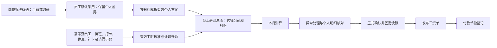

# 岗位薪资、员工总表与月度发薪完整方案

日期：2026-10-31（Asia/Singapore）。项目：D:/RPB。

状态：完整业务方案草案，供用户评审。本轮仅整理文档，没有实现功能、执行迁移、修改员工方案或工资数据，也不构成提交、推送或生产发布授权。本文的“拟新增”不代表系统已经支持。

## 1. 已确认需求与本方案采用的默认取舍

用户已确认：

- 同一岗位同时存在月薪、时薪员工，同岗位员工也可能有个人议定工资差异。
- 岗位薪资、统一员工总表、个人薪资明细、每月测算和正式确认需要形成一条清楚的业务流程。
- 简化日常操作，复用已实现的计算、法定规则、审批、生效与历史保护能力。
- 流程必须导向式、易用，目标是首次使用的管理员不经口头教学，也能完成常规办理并知道异常的下一步。
- 2026-10-31最新决定：线上线下旧工资为开发测试数据，可删除；按新版直接替换，无需旧工资兼容。新版产生的正式工资仍须冻结、审计和合法纠错。

以下为本方案提出的实现方向，尚不冒称用户逐项批准：

1. 采用“岗位＋计薪方式”的标准方案，员工确认采用后形成独立的生效个人方案；个人差异单独保留。
2. 以“员工薪资总表”作为工资首页；月度测算和核对都在总表办理，个人明细从员工行打开。
3. 正常员工不必每月重新选模板、逐项选择费率或逐人重新保存方案；管理员主要处理例外与变化。
4. 普通调薪默认推荐下月1日生效；新员工按合法入职/生效日期办理。首期不新增同月多套方案自动分段计薪。
5. 保留发薪公司结算、现有审批和批次确认守卫。筛选不改变确认范围，待审批不自动成为有效工资。

## 2. 当前能力及真实缺口

本表依据当前源码和接口契约核对，不以旧文档标题中的“本地实现”推断当前生产版本，也不将本次阅读当作新一轮测试证据。

| 环节 | 已有能力 | 本轮需要补齐 |
| --- | --- | --- |
| 岗位薪资默认 | `PositionSalaryDefaultsService`、`ProfilePreview` 已支持按公司/岗位/日期推荐模板 | 现有默认映射同公司、岗位、同生效日只允许一条，不能直接同时承载月薪和时薪默认；需要按计薪方式区分 |
| 标准模板与作用范围 | 母版发布、固定门店采用、未来生效、显式升级及个人差异保护 | 将这些管理概念收进后台业务流程，普通用户看到可采用的岗位方案；保留真实权限和范围校验 |
| 员工个人方案 | 长期生效、当前/未来/历史、来源快照及个人覆盖；标准采用和经济变更治理已存在 | 从员工资料带入员工/公司/岗位，明确选择月薪或时薪，展示完整待遇后确认采用 |
| 法定缴费 | 已有保存的规则版本、CPF事实资料、SDL、CDAC适用声明及计算追踪 | 自动选用合法已生效规则，展示计算原因；缺资料集中提示，减少普通人员选择规则的步骤 |
| 月度工资工作台 | 缺项、未核准/过期来源、重算原因、双基线差异和付款摘要 | 当前展示按技术问题分块，尚无完整的“一员工一行”业务总表；应补只读人员投影，而非由前端拼接多张不完整列表 |
| 工资明细 | `breakdown`、工时口径、项目 `lineage`、收入/员工扣款/雇主费用分类 | 以清晰的业务分组和来源说明呈现，隐藏日常不需要的内部编号、版本和技术码 |
| 正式工资 | draft / calculated / confirmed / published / voided、全量复算比对、来源指纹、付款独立登记 | 用用户理解的状态和上下文按钮串起来，继续调用原命令与确认条件 |
| 历史保护 | 冻结批次、固定方案/政策/来源快照、有效证据及补发补缴链路 | 新页面只投影旧快照；岗位与个人新设置不得反向覆盖历史 |

重要边界：`PayrollSources` 目前遇到同月多份个人方案会报 `PROFILE_MULTIPLE`。因此“同岗位有月薪、时薪员工”可以通过分别配置不同员工方案解决；不能据此承诺同一员工同月自动在月薪和时薪之间分段计薪。

## 3. 方案比较与选择

| 方式 | 优点 | 问题 | 结论 |
| --- | --- | --- | --- |
| 只精简原模板表单和文案 | 改动较小 | 岗位多计薪方式、个人差异、总表与月度流程仍断开 | 不足以满足本次完整需求 |
| 在现有模块内增加按计薪方式的岗位方案选择与员工总表，复用原生效/审批/计薪 | 业务主线清晰，已有规则及历史快照可继续使用 | 需要补默认映射和只读聚合，不只是 CSS 或改菜单名称 | 本方案推荐，承接用户已选定的方向 |
| 另建一套岗位自动计薪和确认系统 | 可自行设计全部操作 | 重复计算、权限、审批、锁和快照，容易出现两套正式金额 | 不采用 |

## 4. 用户主线与页面入口

日常只有三个办理入口：

| 入口 | 主要任务 | 与其他入口的衔接 |
| --- | --- | --- |
| 岗位薪资 | 建立、预览和调整岗位标准待遇 | 供员工确认采用，调整时预览影响员工，不自动覆盖个人方案 |
| 员工薪资总表（工资首页） | 看人员准备情况、本月测算、异常及确认 | 点击员工打开个人明细；顶部提供岗位设置入口 |
| 员工个人明细 | 看完整待遇、个人差异、本月项目和历史工资 | 只编辑所办理的配置或本月调整，返回原公司/月份/筛选位置 |

“每月测算确认”是总表内的一条操作流程，不另造一个需要重新选择员工和公司、重复建立工资的入口。原报表、补发、年度事实和高级政策维护入口继续保留，按权限置于辅助区域。

### 4.1 导向式办理原则

“不用教”作为产品目标和验收条件，不等于上线前已经验证所有用户无需培训。日常操作应让用户始终知道：**正在给哪家公司、哪个月、哪些员工办理；现在完成到哪里；还差什么；接下来按哪个按钮；操作后会发生什么。**

- 同一办理阶段只突出一个主操作，其他动作降为辅助操作；不把模板、规则、测算、确认、发布等平级按钮全部摆出让用户猜顺序。
- 公司、月份、员工和已有岗位资料从上下文带入；只有一个合法选项时直接带入。多个合法公司/候选不能猜选，明确要求必要选择后保持上下文，不在往返页面时重复询问。
- 能从合法资料和规则得出的结果由系统处理，用户只补缺失事实、明确个人差异或处理实际异常；不要求普通工资人员选择费率档位和内部版本。
- 每个阶段同时说明当前结果和下一步，不只显示进度条或“保存成功”。完成标准来自真实后端状态，不能因为用户点击过步骤就显示已核准、已生效或已确认。
- 无权办理时解释需要哪类权限及接续入口，不展示一个无法完成的主按钮；不能为简化操作扩大工资权限或假造审批人。

### 4.2 工资首页按当前状态给出下一步

总表顶部持续显示“发薪公司＋工资月份”。下面显示简洁的办理进度：**准备资料 → 本月测算 → 核对结果 → 正式确认 → 发布工资单**，并突出当前可做的动作。

| 当前真实状态 | 用户首先看到的提示 | 主要动作 |
| --- | --- | --- |
| 尚无可用岗位方案、员工待配置 | 哪些岗位或员工尚未准备好，影响什么 | 设置岗位薪资 / 配置员工薪资，按当前上下文显示其一 |
| 有适用的资料或工时阻断 | 还有多少人、多少班次需要处理，不用先懂错误代码 | 处理待办 |
| 已准备好，本月尚未测算 | 可以按当前有效方案和来源生成本月结果 | 开始测算 |
| 测算后来源发生变化 | 哪些员工需要更新结果；原因不足时不编造具体事件 | 重新测算 |
| 已测算，本月尚未结束 | 当前为预估，结束结算期并满足原条件后才能正式确认 | 核对预估结果；确认不可用原因直接说明 |
| 已测算，可正式确认 | 公司全量人数、金额及异常检查结果 | 确认本月工资 |
| 已正式确认，尚未发布 | 工资已固定，员工暂未看到本期工资单 | 发布工资单 |
| 已发布 | 发布结果和独立付款进度 | 查看工资单；付款按原权限单独办理 |

该表编排主操作，不改变既有 API、状态机或确认条件。已有允许的阻断预览可以保留在辅助查看中，但不能因隐藏问题而提前显示可确认。等待未来生效、等待审批和合法历史兼容等提示，按实际影响区分，不一律制造本月阻断。

已具备有效方案且资料齐全的常规月份，在选定公司和月份后，主线应收敛为“开始测算 → 确认本月工资 → 发布工资单”；用户可以停在正式确认阶段，系统不自动替其发布。

### 4.3 统一待办直接带到问题位置

待办按员工归集，必要时展开到班次。每项只讲清四件事：**谁有问题、缺什么、影响什么、去哪里处理。**例如“某员工的工时核准已失效，当前结果需要重新核准和测算”，而不是只显示 `STALE`、来源ID或版本差异。

问题分为“阻断确认 / 需要核对 / 仅提示”，由真实后端证据和现有守卫确定。点击处理后携带员工、公司、月份、班次等准确上下文，直接定位到对应区域；完成后返回原总表并重新读取状态，保留筛选和分页。不能要求用户自行到多个菜单搜索同一个人，也不能只改前端勾选便将问题清零。

处理结果未知时保留原请求和草稿，提供明确重试；结果过期时说明需要刷新/重新预览。不能为了“一键完成”自动填出生日期、伪造工时核准、删除个人差异或绕过批准。

### 4.4 员工首次配置只引导必要决定

在合法员工档案已保存的前提下，薪资配置按三个业务步骤办理：

1. **确定待遇**：岗位已带入，选择月薪/时薪，系统推荐合法岗位方案；个人议定不同时才展开差异编辑。
2. **补齐必要资料**：已知生日、身份和PR证据等带入，只追问当前确实缺失或需要明确声明的内容，并解释用途。普通用户不选择CPF费率表或内部政策版本。
3. **核对并办理**：展示标准待遇、个人差异、合法生效日期及会发生的动作；符合条件时“确认采用”，需批准时“提交审批”，结果明确显示已生效/待生效/待审批。

前进、后退与展开不丢草稿，也不因经过某一步就暗中产生经济生效。个人差异和特殊选择继续走原审批；返回总表后直接看到该员工的真实准备状态。

### 4.5 正式动作要让用户看懂影响

正式确认前的摘要显示公司、月份、全量人数、应发、员工扣款、实发及公司承担，注明当前筛选外人员也在本次批次内。已有未决申请或来源提示按真实证据说明采用的是哪份有效方案，不把提案金额放进正式金额。

按钮使用“确认本月工资”“发布工资单”等明确动作名，避免只有“确定”“执行”“处理”。确认后的结果说明“工资已固定，下一步可发布工资单”；发布后说明员工可查看的范围及付款仍需独立登记。不得将保存草稿、正式确认、发布和付款统称为“完成”。

### 4.6 易用性验收目标

除金额、权限与历史测试外，增加以下任务式验收；这是计划中的验收要求，不是当前已完成的用户测试：

- 首次使用者能在页面提示下完成一名标准月薪员工配置，并能为同岗位时薪员工提交个人差异，不需要先阅读母版、版本和规则说明文档。
- 常规月份能从总表完成测算、核对、正式确认和发布，不逐人重新选模板、录同一资料或强制打开全部个人明细。
- 遇到缺资料、工时未核准/过期、待重算、权限不足和待审批时，使用者能识别原因并找到正确下一步；不会把未完成当作零工资或正式成功。
- 在桌面和手机上，用户能一直确认公司/月份/员工上下文，处理待办后能回到原位置；主要操作不被一堆同权重按钮或长技术明细淹没。
- 实施验收建议至少邀请3名未参加设计的目标使用者，以合成数据独立完成上述常规任务，记录卡住的位置和所需提示；出现误公司/误月份/误员工确认、误发布或须口头解释才能继续时，应改流程后复验。没有进行该人员测试时，不宣称已验证“无需培训”。

## 5. 岗位薪资方案

### 5.1 同岗位的月薪与时薪

先选择发薪公司和岗位，再维护该岗位实际使用的计薪方案，例如：

| 岗位 | 计薪方式 | 标准待遇示意 | 状态 |
| --- | --- | --- | --- |
| 服务员 | 月薪 | 基本工资 SGD 2600；固定餐补 SGD 150 | 当前有效 |
| 服务员 | 时薪 | 标准时薪 SGD 12.50；其他项目按已配置规则 | 当前有效 |

数值仅为交互示意，不是正式工资或法定计算例子。日薪作为新版支持的计薪方式保留，不强迫转成月薪/时薪，也不为本轮增加新的计薪公式。

标准方案的常用内容：计薪方式、基础工资/单价、固定收入项目、既有加班安排、工时/计薪单位生成方式、合法适用范围、生效日期。用户先看“基本工资、固定收入、需要按工时或本月事实计算的部分”，再按需展开其他配置。

模板版本、母版与门店采用等信息置于“来源与高级设置”，用于追踪与维护，不要求每次计薪都重新选择。固定工资与未来变动工资不能合成一个看似确定的“预计实发”。

### 5.2 公司、门店和版本边界

- 业务分组为发薪公司＋岗位＋计薪方式；默认选择还必须满足当前门店及目标生效日期的既有模板/采用范围。
- 不将一个门店的固定物化模板直接当作其他门店的通用模板。相同公司、相同岗位也不意味着可绕过门店采用校验。
- 同一员工上下文若只有一个合法候选，可以自动推荐；候选缺失或有多个未能唯一确定的方案时明确提示选择，不能取数据库第一条或最近创建的一条。
- 公司通用与门店特定标准如需并存，应在来源配置中明确作用范围及优先级，不能仅靠名称区分。本方案不增加任意重叠默认：一个门店/目标日期/岗位/计薪方式只能有一个有效默认；冲突必须在配置时拒绝或由管理员明确解决。
- 发布新标准不会改变员工现有方案；“更新岗位标准”和“申请调整已有员工工资”是不同业务动作。

### 5.3 按计薪方式直接采用新版默认

用户已取消旧工资兼容要求，不再设计V107回退、旧无计薪方式API或新旧映射共存。线上线下旧工资配置可在核实范围后清理，日常入口直接使用新版默认。

1. 推荐必须按租户、公司、门店、岗位、计薪方式和目标生效日期唯一解析；缺失或冲突明确提示，不能猜选或读取旧映射回退。
2. 已生效停用返回无可用默认，未来配置不提前接管。
3. 新建员工、个人薪资、岗位预览和工资总表采用同一个解析器，不保留第二套旧推荐入口。
4. 已明确选择合法方案后形成员工有效个人待遇；岗位默认变化不自动覆盖个人差异。此保护针对新版正常业务，不承担被清理旧工资的迁移兼容。
5. 保留有价值的范围、金额审批、法定规则与版本能力；旧映射/API/解码专用分支及其过时测试随替换删除，不重写已经正确的计算算法。

## 6. 新员工、个人差异与后续调整

### 6.1 新员工一次性设置

从员工资料或总表的“配置薪资”进入，自动携带员工、发薪公司、岗位与合法生效日期。

新增员工先保存最少必要的员工资料，取得合法员工与公司上下文后，在同一办理流程中继续设置薪资；不把工资写入偷偷塞入员工资料保存接口。只有员工维护权限的人员可完成档案录入并看到薪资待办提示，由有工资权限的人员接续，不因此获得金额读取权。

1. 选择月薪或时薪；原有合法用工/薪资信息能够唯一确定时带入，否则由管理员选择。
2. 推荐合法岗位方案，完整展示标准待遇、适用条件和来源。
3. 查看或填写个人事实资料及 CDAC 适用声明，系统提示还缺什么。
4. 默认原样采用；若有个人议定工资不同，仅编辑需要不同的项目。
5. 按原治理规则办理：合法首次标准采用走现有标准采用；个人经济覆盖、特殊选择及其他需要批准的内容进入原申请/审批流程。

普通页面只显示当前可执行的下一步，例如“确认采用岗位方案”或“提交个人差异审批”。不能让同一个按钮忽略两者的权限和生效差别，也不能为省步骤伪造批准。

### 6.2 个人差异分三类

| 内容 | 保存位置与期限 | 对其他人的影响 |
| --- | --- | --- |
| 长期个人工资差异，例如月薪2750、岗位标准2600 | 新生效个人方案，保留标准来源及差异 | 不改岗位标准、不改同岗位其他员工 |
| 当月一次性项目，例如本月奖励或扣项 | 原月度调整/经济申请，限定指定月份 | 不延续到下个月，不伪装成长工资 |
| 真实身份、出生、PR等资料及适用声明 | 沿用现有事实与法定资料来源、证据和权限 | 只影响合法适用范围，不能凭姓名推断或改写已确认工资 |

个人明细显示“岗位标准 / 本人采用 / 差异原因 / 生效日期 / 办理状态”。现有个人工资高于或低于新标准时都保留，不自动“校正”。

### 6.3 岗位变更、调薪和未决申请

- 换岗位只更新岗位事实，不自动更换员工工资；界面提出新岗位标准供预览，用户显式选择是否申请调整。
- 标准工资更新后，可预览差异并按已有批量申请能力办理；逐人结果、原请求重试、个人覆盖及三方冲突保护保留，不一键强制覆盖全部员工。
- 首期普通调薪默认推荐下月1日。月中入职按合法入职日期办理；确需同月多方案/计薪方式切换时保留原阻断并说明原因，不能通过新 UI 绕过 `PROFILE_MULTIPLE` 或自行按天摊分。
- 待审批、驳回或撤回不改变现有有效方案；未来已批准方案到期才使用。当前总表清楚显示“本月仍按哪份有效方案计算”。
- 本轮不静默新增“所有未决申请一律阻断工资确认”的规则；是否可确认仍由现有后端守卫决定。对影响本月的未决申请给出明显提示，不把提案金额混入正式计算。

### 6.4 三个典型办理例子

| 例子（合成示意） | 管理员办理 | 后续行为 |
| --- | --- | --- |
| 服务员A按标准月薪2600、餐补150入职 | 选择月薪，核对岗位待遇和个人事实，按标准采用条件确认 | 生成独立个人方案；以后月份沿用，当月结果仍按该方案的既有计薪方式和合法事实测算 |
| 同岗位B按时薪入职，个人议定13.50而岗位标准12.50 | 选择时薪，只修改个人单价差异并提交原审批 | 批准且到期后采用13.50；不会修改A或岗位标准，也不要求B选择CPF费率表 |
| 公司把该岗位月薪标准从2600调到2800，已有员工C议定2750 | 预览哪些员工有差异，明确选择是否申请调整及生效日期 | C不会自动变成2800；历史月份继续显示原冻结工资，新增员工按目标日期取得新推荐 |

这些例子说明配置和办理路径，不预先给出尚无工时、缴费资料或批准结果的实发工资。

## 7. CPF、SDL、CDAC 的自动适配与可解释展示

不按年龄×身份复制岗位模板。岗位定义待遇，员工事实和目标工资期间用于解析合法已保存的法定规则。

| 项目 | 普通操作界面 | 高级/例外处理 |
| --- | --- | --- |
| CPF | 展示所用身份资料、年龄/PR阶段及规则匹配结果，分别列员工与公司承担 | PR特殊选择及依据、资料修正、规则维护沿用现有权限和批准要求 |
| SDL | 自动计算并列入公司承担，不当作员工扣款 | 按现有适用规则和异常处理，不扩大为新的豁免机制 |
| CDAC | 明确适用/不适用声明后，按现有规则计算 | 豁免、手动金额、重复 CDAC 项及覆盖说明沿用原申请与确认保护 |

约束：

- 工资期间使用对应生效政策，不按打开页面当天的年龄、当年的默认规则或“最新版本”重算历史。
- 出生日期与 PR 资料优先复用已有事实、引用及确认方式；无法确认或缺失时显示“待补资料”，不可静默按零扣款处理。
- 公民/PR身份本身不足以推断 CDAC 适用；不凭姓名推断族群，不为本轮新设未经确认的族群自动判断规则。
- 旧配置中的手工 CDAC 与自动项目不能重复扣；转换前继续执行现有重复项阻断与显式处理。
- 法定规则版本由现有政策维护模块管理；普通人员查看适用说明，只有有权人员进入规则维护。
- 本轮不新增费率、计税/缴费公式、未支持基金或外部申报能力；法定计算能力缺口仍保持阻断，不为让总表变绿而放行。

政策事实的官方参考：[CPF](https://www.cpf.gov.sg/employer/employer-obligations/how-much-cpf-contributions-to-pay)、[SDL](https://www.cpf.gov.sg/employer/employer-obligations/skills-development-levy)、[CDAC](https://www.cdac.org.sg/cdac-funding-info-information-for-employers)。实现时核对有效政策及日期，本方案不复制固定费率表。

## 8. 员工薪资总表

### 8.1 页面结构

顶部选择发薪公司、月份，辅以门店、岗位、计薪方式、姓名/员工编号和办理状态筛选。普通工资人员默认落到其合法公司；多个合法公司时明确选择，不使用隐藏的错误公司上下文。

顶部摘要显示：纳入人数、待补资料人数、待核准人数、需重算人数，以及来自同批次有效快照的应发/员工扣款/实发/公司成本。无计算或存在阻断时明确“待完成”，不能把未知金额当作零或用不完整人员小计冒充公司应付总额。

默认表格只保留业务重点：

| 员工 | 岗位 / 月薪或时薪 | 应发 | 员工扣款 | 实发 | 本月状态 | 下一步 |
| --- | --- | --- | --- | --- | --- | --- |
| 示例员工A | 服务员 · 月薪 | — | — | — | 薪资待配置 | 配置薪资 |
| 示例员工B | 服务员 · 时薪 | — | — | — | 工时待核准 | 查看待办 |
| 示例员工C | 厨师 · 月薪 | 计算结果 | 计算结果 | 计算结果 | 测算完成 | 查看明细 |

各明细、公司承担和相较上次/上月变化按需查看，不在主表一次铺出几十列。只在月薪/时薪有业务意义时显示其单价与单位，避免把标准月薪当作已算出的本月应发。

金额字段需明确映射：“应发工资”使用原 `breakdown.gross`，报销在个人明细单列；“实发”使用 `breakdown.net`；“公司成本”使用同一口径的后端结果。“员工扣款”由后端将既有员工CPF、CDAC及其他扣款分类汇总提供，不能直接假定旧 `deductions` 字段已经包含所有扣款。前端不自行用应发减可见项目反推实发。公司SDL汇总仍使用原公司口径，不能简单将逐人显示额相加替代已有舍入规则。

### 8.2 人员和金额口径

- 人员按发薪公司＋工资月份＋员工归集，跨门店出勤不重复计人或计薪；保留既有跨公司归属边界。
- 无个人方案、无合法核准、未测算人员也要在所属待办中可见，不能因为金额表没有该员工就从总表消失。
- 是否纳入按该工资期的有效雇佣/归属、已有批次和原计算规则确定，不能仅按“现在在职/启用/现在岗位”筛掉离职员工或旧工资。
- 总表未冻结时呈现当前合法资料与测算；已确认/发布月份呈现批次快照，不能用当前员工/岗位/方案覆盖历史展示。历史缺字段显示“未记录”，不编造来源。
- 门店、岗位、姓名、分页是查看筛选。公司全量进度和筛选结果明确区分；不能把当前页合计当总金额。
- 正式确认仍针对原公司/月批次。按钮说明全量人数及当前筛选外人数，不允许“只看了一个岗位，却无提示确认整个公司”，也不新增跳过异常员工确认剩余人的通道。

### 8.3 状态和操作

员工行可按以下优先级展示主要问题：资料待补 → 工时待核准/过期 → 待重算 → 测算完成 → 已确认。个人待审批/未来方案附在来源说明，付款进度独立展示。

“核对”是管理员检查业务的动作，本轮不新增必须逐人点一次的持久化审批环节。正常人员允许在总表集中检查，异常人员才需要进入个人明细。不能把“打开过明细”当成批准、已付款或已正式确认。

## 9. 员工个人明细

总表默认仅展示员工汇总；点击员工姓名或“查看明细”后，才展开该员工本月的三组金额明细。桌面使用与总表关联的详情区，手机使用单列详情；返回时保留原公司、月份、筛选和分页，不重复选员工。查看不改变审批、确认或发布状态，也不要求逐人打开后才能确认整批工资。

| 金额分组 | 展开后清晰展示 | 每项依据 |
| --- | --- | --- |
| 收入 | 基本工资、加班、津贴及本月调整；调整保留正负方向与既有分类 | 基本工资对应有效薪资方案及折算依据；加班对应有效核准工时、单价与计算结果；津贴对应适用项目与条件；本月调整显示原因及原记录 |
| 员工扣款 | 员工 CPF、CDAC 及其他扣款，显示分类金额和扣款合计 | 对应工资期适用规则、计费基数及原计算明细；其他扣款显示项目和原因，缺失的历史依据显示“未记录” |
| 公司承担 | 雇主 CPF、SDL、已有其他公司费用及公司总成本 | 显示各项金额、适用依据与公司成本构成；公司总成本是汇总结果，不作为费用再次累加，不混入员工扣款 |

三组之外，仅保留员工、工资月份、测算/确认状态及应发、实发等必要摘要。本人薪资待遇、实际工时与有效核准工时的区别、计薪单位、来源版本、处理记录和历史方案均作为相关项目的“查看依据”按需展开，不再并列铺成额外金额分组。报销按原口径独立标注，不混入基本工资或改变应发定义；本月调整仍按原收入/扣款性质归组，不重复计入两组。

金额、应发/报销/扣款/实发/成本口径一律采用现有后端 `breakdown` 与计算结果，不由新前端重新拼公式。项目保留稳定身份与来源，不按同名项目合并或去重。

历史工资从冻结快照直接读取，不能用当前方案重新测算。普通员工只看既有本人已发布工资单投影；管理界面的身份资料、内部理由、他人信息不能随详情共用组件泄露。

## 10. 每月测算、核对、正式确认与付款

### 10.1 与打卡、补卡、请假及核准工时的衔接

**2026-10-31考勤规则对齐：**四类考勤计薪方式、正常自动生效、默认正常登记例外、无排班请假和合同加班待遇，以[月度异常考勤最终业务版](2026-10-31-workforce-exception-attendance-design.md)为准。下文已有打卡核准链路描述当前能力；新方式实施后通过统一有效来源衔接，不能要求所有员工补打卡或人工核工时。定位方式与考勤计薪方式独立。

本轮进一步确认的业务主线为：**有效员工薪资方案 → 本月测算 → 总表检查异常 → 按需查看个人明细 → 正式确认 → 发布工资单**。其中“本月测算”读取既有考勤与核准来源，不另造人工录工时的重复流程。

对需要考勤的员工，来源链路为：排班及实际打卡/休息 → 补卡、已批准请假等事实合并 → 实际考勤计算 → 当前有效的工时核准 → 工资可用来源。薪资方案和法定政策是另一组输入，二者在测算时按公司、员工及工资期间共同解析。

| 方案类型 | 测算适配 | 总表和个人明细应说明 |
| --- | --- | --- |
| 时薪 | 采用当前有效核准来源，按原规则计算正常工时、加班及带薪假对应金额，使用本人的有效单价 | 实际工时、有效核准工时、正常/加班/带薪假计薪口径分别显示 |
| 与考勤关联的月薪/日薪 | 按现有工作日、日工时、计薪单位生成和折算规则计算，不能把月薪随意换算为“打卡小时×时薪” | 标准工资、应计/应付单位、折算及收入项目的原计算依据 |
| 自由/免工时核准的固定月薪 | 满足原公司当月有效雇佣和方案条件后，沿用固定基本工资规则；不要求补打卡或伪造工时核准 | 标明“免工时核准/固定工资”，不显示虚假的满勤工时或人工批准 |
| 免打卡按合同计发（本次新增目标） | 不生成虚拟出勤或工时核准；按有效合同计薪单位、请假/入离职政策及批准调整计发，加班完全按合同约定 | 明示合同依据和适用条款，缺依据保持待补；不能套用旧自由员工全额规则 |
| 默认正常、登记例外（本次新增目标） | 已结束的有效工作安排生成可追溯的安排工时，批准请假/缺勤及额外工作进入同一有效来源计算 | 实打工时与按安排认定工时分清；未来、未安排及未决例外不能视为正常 |
| 人工核定单位方案 | 保留既有人工月/日薪单位、核对和金额治理，不自动切换为考勤生成 | 明示人工单位来源；工时证据不可得不等于应付为零，也不凭该显示状态新增确认阻断 |

具体约束：

- 实际打卡工时、有效核准工时和计薪单位分开显示。排班工时不冒充已工作时间，异常获准也不自动补足未工作秒数。
- 对需要核准来源的自动计薪，缺核准、核准已过期或来源冲突必须在总表定位到员工/班次；相关金额保持“待核准/待重算”，原阻断预览中的零占位不得显示为正式零工资。
- 补卡、请假变动或其他考勤事实改变后，原核准可能失效；先按原流程重新核准，再重算工资。不能只刷新金额而继续消费过期核准。
- 原工时核准与金额审批分别生效。需额外补款或扣款时走原月度项目/经济申请，不因“异常已处理”新增工资；同一事件不能重复折减工时后再无依据扣款。
- 跨门店出勤按现有公司归属和来源身份汇集；跨月周上下文只服务原加班判定，不重复记成本月工资来源。
- 正式确认前再次检查所有适用来源及全量复算一致性；确认后冻结当时来源和结果，后续考勤调整不得直接改写已确认/发布工资。

“按需查看个人明细”用于异常处理、重点核对或抽查，不新增所有正常员工必须逐人点开一次才能确认的步骤。月中缺资料可以先看到待办或有限预览，但没有解决适用阻断前不能正式确认。

上述衔接已依据当前 `PayrollSources`、`PayrollGeneration` 及工时/项目来源契约核对；它描述本方案应复用的计算边界，不代表新总表已经实现。

### 10.2 月度操作和确认边界

| 阶段 | 用户主要动作 | 真实含义与限制 |
| --- | --- | --- |
| 准备 | 打开公司/月总表，处理集中待办 | 读取不创建个人方案、不生成工资、不写入审批 |
| 测算 | 点击“开始测算”或“重新测算” | 复用原批次创建/计算，产生可核对的测算结果；正常方案跨月沿用 |
| 核对 | 看总表异常、差额及必要的个人明细 | 缺资料/未核准/重复来源/不支持组合仍阻断；未知金额保持未知 |
| 正式确认 | 授权人确认公司本月工资 | 复用原全量复算与指纹/版本校验，固定当期正式快照 |
| 发布 | 按原规则发布工资单 | 与正式确认分开，不通过打开总表自动发布 |
| 付款登记 | 原付款入口登记/查询进度 | 与批次状态独立，不将确认或净额为零当成银行已转账 |

规则保留：

- 月中可以查看基于已有事实的测算，但小时制未来工时不足时不能承诺完整未来工资。固定方案的假设预估也要标明假设，不把它显示为正式应付。
- 现有正式确认要求月份结束、来源当前有效、问题清零、版本一致、全量复算相同及既有本人/权限限制；新总表不放宽这些条件。
- 核对后若补卡、请假、工时核准、员工方案、政策或月度金额改变，结果标记需重算；不能静默确认旧结果。
- 现有自由/免工时核准员工的固定工资规则保持，不为让他们通过待办而伪造打卡或核准。
- 待审内容不参与正式有效解析；假设影响预估与正式月度批次分离，不把假设写入批次/缓存冒充生效结果。
- 读页面不写工资；创建/计算/确认/发布只使用原显式命令。重复点击和结果未知沿用原 commandId、固定载荷及重试，不重复建批、重复发薪或默默换版本。

### 10.3 快速核对打卡与核准工时

管理员办理入口按公司、月份及授权门店保留上下文，默认突出“待处理异常”，同时可切换全部员工。按员工汇总排班、实际工时、有效核准工时、差额和待办数；点击员工才展开每日打卡、休息、请假与加班依据。排班、实际、核准和计薪单位不能混为同一列，也不以缺失资料显示零工时。

- 当前正常记录的人工批量核准入口继续保留，先显示选中人数、记录数和日期，仅处理满足权限、来源有效性、本人限制及原核准规则的记录。新的目标按[异常考勤最终版§5](2026-10-31-workforce-exception-attendance-design.md#5-系统正常生效与异常核准)增加独立、可追溯的系统正常生效，不能仅凭前端隐藏异常或绕过经理专审实现；筛选和分页不能静默扩大确认范围。
- 异常分别呈现漏卡、重复打卡、休息、请假、加班、跨夜等已有业务问题；每条说明影响、原始依据和合法办理入口，不通过新页面自行补工时或免除原审批。
- 批量能力须先核实原核准接口是否支持；如需新增命令，作为明确增量评审实现，不用前端循环提交冒充原子批量成功。结果逐项明确成功、失败和未处理，刷新并发变化，不整批误报成功。
- 处理后返回原列表和滚动位置，更新剩余待办；保留当天及跨月归属依据，不能把跨夜班截断、重复归月。
- 工时核准后明确显示“工时已核准，工资待测算/重算”；来源变化时显示“需重新核准”或实际适用状态，不能把核准成功当成工资已经更新。

### 10.4 工资差异检查与错误处理

总表按需突出相较上月的金额变化，个人明细显示基本工资/单价、计薪单位、加班、津贴、月度调整及员工扣款的差异依据。比较须采用相同员工、合法公司范围及明确月份的实际结果；首次发薪、不可比或历史缺依据显示“无可比数据”，不编造变化原因。新员工、离职、零工资及明显变化集中提示；具体阈值在实现时明确，不默认新增金额审批或确认阻断。

发布前也须区分是否已正式确认：未确认时返回原资料办理，按适用规则重新核准和重算；已确认但未发布时，同样受冻结守卫约束，不能直接编辑金额。已确认/发布错误只展示当前状态下已有合法纠错入口；如需补发、冲正或重开而现有流程不支持，应明确提示不支持并说明后续办理边界，不新增直接覆盖历史的捷径，也不以普通本月调整掩盖旧期纠错。

### 10.5 员工每月查薪

员工入口默认打开最近已发布工资月份，清楚展示工资所属月份、本期应实发金额和独立的付款状态，再查看本人收入、员工扣款及各项依据。未发布测算不向员工冒充正式工资；无工资单、历史缺项和付款状态未知分别说明，不用零金额或“已到账”代替。

- 管理端个人明细保持§9的收入、员工扣款、公司承担三组；员工端沿用既有本人已发布投影和字段权限，不因共用组件新增公司成本、内部审批理由或他人工资可见性。
- “本期应实发”指工资计算结果；只有现有付款证据支持时展示对应付款状态，登记付款也不能无依据表述为银行到账。部分付款等情况按已有付款服务实际能力呈现，不在本轮虚构支持。
- 员工发现疑问时，可定位具体月份及工资项目、查看依据，并显示组织已配置的有效反馈入口；没有现有在线申诉流程时不放置无效按钮，不暗示已经提交工单。本轮不新增聊天、工单或申诉审批系统。
- 手机优先让员工看清所属月份、到手金额及收入/扣款，长项目名和依据可展开，返回和切换月份不丢上下文。

### 10.6 提前结薪独立办理与月底对账

用户明确要求：提前结薪单独处理；已经提前正式结清的范围，不再纳入月底重复确认；月底统计必须合上。提前结薪因此纳入完整需求，作为独立业务增量，不再列为本轮排除项；当前方案不代表原系统已支持，也不通过移除普通月度批次的月底守卫来实现。

- **独立入口与正式结果**：提前结薪需显示员工、发薪公司、工资所属月份、覆盖期间、结算截止日及纳入来源，按独立授权动作测算、核对、确认和发布。普通月度流程继续保留原月底确认守卫。提前结薪的确认不能仅靠前端标记“已处理”。
- **月底避免重复**：同一公司、员工、所属工资期及已结清覆盖范围必须有唯一可追踪归属。提前正式结清后，月底总表显示“已提前结薪”及原记录入口；对应范围从月底待确认/待发薪集合中排除，不能再次生成或确认相同工资。提前结薪仍处于草稿、测算、待审等未正式结清状态时，不据此排除员工，也不能漏结工资。
- **统计保留**：月底统一汇总“已提前结薪正式金额＋月底正式结薪金额＋合法的独立差额调整”，按相同项目口径呈现应发、员工扣款、应实发及公司承担，不把提前结薪人员隐藏或按零工资统计。测算、作废或被替代结果不重复计入正式总额；同时展示已提前结薪、月底待结及差额待办的人数和金额范围。
- **付款另行对账**：正式应实发、已登记付款和未付余额分开；提前结薪已确认不代表已转账。月底既要核对工资汇总，也要核对付款记录，不能把先前已付款金额再次放入本次付款清单；具体余额及部分付款沿用实际付款能力，不凭工资状态虚构到账证据。
- **结清后的变化**：已提前结清范围内发生补卡、工时更正或金额变化，原快照保持不变，新增差额进入独立补结/纠错待办，保留原结薪关联和原因；不得把员工无提示重新放回月底整月确认。未结清的后续期间如有应付，也须通过明确的独立后续结算办理，并与已结期间防重，而非重复整月计薪。
- **当月法定口径一致**：提前结薪和月底不能各自独立套用整月限额、舍入或缴费规则后简单相加。复用既有法定规则，并对同一员工、公司、工资期的累计结果、已结金额和合法差额建立一致口径；无法准确处理时阻断提前正式结薪，不用预估值冒充正式结果。
- **人员与金额均可核对**：月度总表能从员工下钻到提前结薪、月底结薪及差额来源，每份正式金额只归集一次。人员总数按员工去重，结算单数量单独显示，不能把多张结算单当作多名员工。

实施前必须明确提前结薪适用情形（如离职终结或其他提前结清）、覆盖期间、截止时点、后续期间处理、法定累计及独立确认权限，再评审数据结构、命令及防重约束。此处不得默认“预支工资”就是正式结薪；预支与提前正式结清是不同业务，预支不据此排除月底应付。

完整管理员导航为“核对考勤异常 → 核准工时 → 测算工资 → 检查金额变化 → 正式确认 → 发布工资单 → 按现有入口登记付款”；提前结薪从独立入口办理，月底在总表统一对账。此导航不将所有员工一律强加考勤核准步骤：免核准固定工资及原合法人工单位方案仍按§10.1办理。准备已完成且资料未变化时直接引导下一步，不每月重复配置。员工导航为“选月份 → 看本期应实发 → 查看收入/扣款依据 → 按有效入口反馈疑问”；同月存在提前结薪及差额时清楚列明关联记录，不误显示为重复工资。

### 10.7 个人补发与原工资、月底结薪的衔接

个人补发纳入本次完整需求，提供独立办理入口；不能仅以本月普通调整替代已确认工资的纠错，也不把补发员工重新纳入月底整月重复确认。具体能力尚需实现前核实原服务并单独设计，不代表现有接口已支持。

导向式流程：**选择员工及原工资月份 → 选择补发原因 → 填写项目或引用更正依据 → 测算差额 → 核对审批 → 正式确认 → 发布补发工资单 → 登记付款**。从原工资个人明细进入时自动带入员工、公司、所属期及原单，避免重复选择；每阶段突出下一步，沿用各自权限和审批守卫，不通过页面编排自动批准。

| 原业务状态 | 办理路径 |
| --- | --- |
| 原工资未正式确认 | 修正原方案/工时/项目来源，按规则重新核准与测算原工资；不另建同范围补发单 |
| 原工资或提前结薪已正式确认，存在少算/漏算 | 创建关联原正式结薪记录的独立补发单，只结算尚未结清的合法差额；原工资及已确认补发快照保持不变 |
| 工资计算正确，仅未付或未付清 | 沿用原工资/补发单付款路径，不再次生成工资收入或补发工资单 |
| 测算发现应扣回、跨公司归属不明或无法支持的更正 | 明确提示并转合法纠错流程；不得以负数补发、跨公司抵销或无依据本月扣款绕过原保护 |

补发要求：

1. **金额有据**：展示原正式金额、适用更正后金额、历次已正式结算差额及本次待补差额，区分收入、员工扣款、公司承担。补发原因、原工资关联、工资所属期间、来源身份及适用版本可追溯；工时更正引用有效核准，人工金额按原权限和经济申请规则办理。
2. **防重复与并发**：差额基于同范围原工资及所有已正式确认的补结/补发累计计算，不能仅减去“已付款金额”；已确认未付款补发也占用已结算范围。草稿/待审单明确标识，并通过来源关联、版本校验、命令幂等与并发冲突保护避免同一漏项重复确认。后一次更正只补尚未结算差额，作废处理按实际合法状态规则执行，不删除历史来腾出额度。
3. **法定差额**：使用所属工资期及适用规则，核对原结薪与历次补发累计后的合法缴费结果，计算本次应处理差额；不得复制原扣款比例、重复使用整月限额或擅自将所有项目当作相同工资性质。跨期规则、舍入及当前引擎不支持情形须明确验证，无法准确测算时阻断正式确认，不能预估入账。
4. **正式动作分开**：补发测算、申请/审批、正式确认、工资单发布及付款分别表达；复用原能力时不混入原月批次或放宽其月底确认守卫。非月底补发应使用经评审的独立命令与适用时点校验。重复点击、断网重试和未知结果不产生重复补发或重复付款。
5. **所属期与付款期分开**：原期已冻结快照保持不变；所属期的补充汇总可追溯展示“原正式工资＋历次正式补发/合法差额”，并注明新增记录及汇总时点，不伪装成原冻结报表。付款统计按实际付款记录及日期归集，补发单的工资金额不因付款跨月再次计入另一个月份工资。月末汇总引用唯一正式记录，避免同时从月批次、补发单及付款记录重复计收入。
6. **员工看懂**：独立工资单清楚标注“补发某年某月工资”，显示关联原期、补发收入、员工扣款、本次应实发及付款状态，支持查看依据。员工端仅使用本人已发布且有权查看的字段，公司承担和内部审批信息仍按原权限控制；未支付不显示为已到账。
7. **提前结薪一致**：提前结清后遗漏项目走本节补发；未结后续期间走明确后续结算路径，不能一律当作更正旧期。月底总表保留提前结薪、补发和待办入口，已结范围不重新进入整月确认。提前结薪、补发及月底结薪的归集和法定累计口径必须一致。

## 11. 模块复用与必要增量

### 11.1 复用的拥有者

- 岗位事实：`positions` 与原员工档案。
- 标准待遇：既有模板发布/门店采用与固定来源。
- 个人有效方案：`PayrollConfigurationService`、有效证据、工资变更申请及审批。
- 计算：`PayrollSources`、`PayrollGeneration`、既有计算器与增量比较。
- 法定规则：`statutory`、CPF/SDL/CDAC及已有适用验证。
- 确认/发布：`PayrollBatchService`，不另建状态机。
- 明细/历史/付款：既有 breakdown、lineage、工资单投影、报表和付款服务。

### 11.2 需要新增或调整的能力

1. **按计薪方式区分的岗位方案映射**：现有 V107 不能直接满足。推荐增加兼容的映射/选择能力，不修改旧迁移或静默重解释旧 snapshot。精确表结构、索引、DTO 和路径留到实现前 API/数据库评审确定；必须满足同一合法上下文唯一默认、并发冲突和不可跨作用域使用模板的约束。
2. **员工总表只读聚合**：组合合法人员范围、方案准备度、问题、同一批次工资行和付款摘要。无批次、无方案、冻结与缺失金额都需有明确契约；分页、筛选、全量范围与数据来源时间分开返回。
3. **个人办理汇总**：复用原员工/方案/工资快照，明确长期与本月调整的写入目标，不把所有配置塞进一个大表单或大服务。
4. **页面流程编排**：主入口减少，已有后台功能保留；标准采用、个人申请、月度调整按原权限办理。来源变化返回明确需刷新/重算，不在前端自动替用户确认。

工时汇总、异常直达、批量核准、工资差异对照、员工查薪导航及纠错入口均纳入本方案交付范围；先复用原拥有者，未有能力则在相应模块明确新增，不能仅修改总表展示就声称全链路完成。提前结薪独立流程、个人补发及月底去重归集纳入需求，需单独设计实现；银行实际付款及新增申诉系统仍不在本轮范围。

聚合应在所属 payroll 查询层内按一致来源组织，避免前端逐员工多次请求/N+1，也不复制计算器。金额使用原十进制字符串；前端不参与精确工资运算。新增读取不扩大同源写白名单，新增写入继续使用原窄权限及命令保护。

## 12. 旧数据兼容与历史工资保护

| 现有数据 | 本方案处理方式 |
| --- | --- |
| 已确认/发布工资、付款及冻结快照 | 不回填、不覆盖、不重新计薪；从原快照投影新总表和详情 |
| 已有合法个人方案和个人覆盖 | 原有效日期、金额、来源及批准证据继续使用，不因岗位默认变化被替换 |
| 旧岗位单默认映射 | 保留原接口语义和旧客户端路径；新 UI 按§5.3统一解析，仅在无对应新配置时使用匹配方式的合法旧候选。存在范围/基准不明或多义时标记待整理，不默认为月薪、不按创建时间猜 |
| 旧方案缺来源或未登记的新证明 | 继续按现有 legacy-valid/证明验证处理；不批量伪造来源、审批或新方案 |
| 旧手工缴费/个人调整 | 按原兼容规则读取；改为自动时显式预览和处理冲突，不能自动删除或叠加 |
| 未确认批次 | 来源变化按原规则重算；无来源变化不为 UI 改名强制重建工资 |

禁止对旧工资 JSON、新旧默认映射或批准结果进行无授权的批量“修正”。确需数据库增量时使用新增迁移，不编辑 V001–V113 等既有迁移；不把展示用字段加入旧快照重写或改变旧哈希。

上线前后对既有表、方案、确认/发布工资、付款及审计做受控完整性核对；没有业务写入时应一致，有合法并发业务时按证据区分，不能以恢复旧库掩盖差异。布局及读取改动可按兼容制品回退；一旦有新映射写入，须先验证旧应用兼容能力，不自动回滚数据库。

## 13. 权限、界面与业务范围

- `employeeManage` 不因此获得个人工资金额读取权；工资总表和详情复用公司薪资授权。总部也不能仅凭一个角色名称读取未授权公司的工资。
- 岗位标准的可见、维护、门店采用及个人工资权限沿用各自拥有者，不用新总表把这些授权合并。
- 公司/月确认、本人限制、历史来源门店/AppGate及离职人员范围校验保持。
- 桌面与手机沿用 [公共布局指南](../../frontend/PAGE_LAYOUT_CONSISTENCY_GUIDE.md)，不新增另一套页面宽度或悬浮操作栏。主表重点列保持精简，手机以员工行摘要进入个人详情。
- 本轮不涉及银行实际转账、自动法定申报、真实缴费、薪资合同自动变更、全族群基金扩展或新的复杂薪酬公式。

## 14. 实施顺序与完成判定

本节是供评审的交付顺序，不是已经获准执行的编码计划。

| 阶段 | 交付内容 | 验收重点 |
| --- | --- | --- |
| 1 | 统一业务入口、总表与个人明细只读投影 | 人员不漏、不重复，金额/未知/冻结口径正确，权限不扩张，历史不变 |
| 2 | 岗位月薪/时薪标准选择、员工标准采用与个人差异 | 同岗位多方式并存，明确来源，首次采用与差异审批正确，新版唯一默认解析 |
| 3 | 总表内测算、问题处理、正式确认和发布衔接 | 无重复批次/操作，不绕过月底/本人/核准/全量确认守卫，筛选不改变确认范围 |
| 4 | 全链路集成、历史保护、响应式及发布准备 | 模板变化/个人差异/身份变化/重算/冻结/付款等回归与真实登录验收 |

四个阶段共同构成本次完整方案；只完成入口改名或总表外观不能标记整个需求完成。

## 15. 验收场景清单

1. 同公司同岗位同时配置月薪和时薪，分别分配给两名员工，不互相覆盖；个人议定金额只影响本人。
2. 无默认、多个合法候选、模板停用/升级/超范围时不自动猜选；跨租户、公司、门店不可泄露或采用。
   同时验证按计薪方式唯一解析、停用无回退、未来配置不提前接管及各入口推荐一致；不保留旧无方式API兼容。
3. 新版日薪、个人差异及已批准未来方案按生效期保持；换岗位、改标准不自动调整个人工资。旧测试工资和默认不迁移。
4. 新员工生日/身份/PR日期/适用声明缺失时清晰定位；不得静默零扣；自动与手工CDAC冲突继续阻断。
5. 按目标工资期间匹配规则；生日、PR阶段、跨年政策及身份变化按原引擎日期边界处理，不改历史。
6. 无批次、无方案、尚未核准、离职当月、跨店、多页、当前资料已变化等情况，人员归集和金额含义正确。
7. 默认与个人差异、长期项目与一次性项目分清；组件明细保留来源、工时口径及金额分类，无重复扣算。
8. 月中预测和未来时薪资料不完整不冒充完整月薪；同月多方案保留现有阻断；自由员工规则不被改变。
9. 待审/驳回仍使用旧有效方案，未来批准按日期生效，个人详情和总表状态一致。
10. 测算后补卡/核准/调薪/政策变化必须重算；重复点击、断网重试、陈旧版本和并发确认均有原保护。
11. 门店/岗位筛选或分页不改变公司批次确认范围；原本人限制和问题清零要求不被新入口绕过。
12. 确认/发布/付款状态独立；旧冻结金额、付款记录及工资单内容/哈希保持，没有把重算写回已确认历史。
13. 仅员工管理权限、仅工资权限、总部合法公司与历史来源门店的读取/写入边界分别验证。
14. 桌面与约390/320px实际手机视口、中英文、长项目名、缺项/错误/加载/空状态以及详情返回上下文均验收。
15. 以首次使用者的实际任务验证§4.1–4.6：每阶段下一步明确、正常流程无需逐人重复配置、异常可准确定位、正式动作影响可理解；记录真实卡点，不以按钮存在或进度条完整代替易用性验收。

16. 正常工时可按明确选中范围批量核准；权限不足、来源过期、部分失败和断网重试结果准确，不跨页扩大范围、不绕过本人限制、不重复批准。
17. 异常处理后返回原员工和列表位置；核准成功后工资待重算可见；跨夜/跨月归属及不同计薪方式不漏算、不重复算。
18. 上月比较采用合法可比结果；首次工资、缺失依据、真实零工资和未测算分清，差异提示不无依据阻断确认。
19. 员工仅看到本人已发布且有权查看的字段，手机可完成选月、查看应实发、收入/扣款依据及有效反馈入口；工资发布、付款登记和银行到账不混淆。
20. 已确认未发布及已发布错误均不能直接改历史；仅提供合法可执行纠错路径，不支持情形明确说明。普通月中测算不能绕过月底确认守卫；提前结薪使用独立流程。
21. 提前正式结薪后，已结范围不进入月底重复确认或付款清单；未正式结清不误排除。月底汇总完整包含提前结薪、月底正式结薪及合法差额，人员去重，项目金额与付款余额可追溯。
22. 提前结薪后补卡、返岗/后续期间或金额更正只进入明确后续结算/差额路径，不改原快照、不重复整月计薪；同月法定累计、限额及舍入验证一致，预支不冒充结清。

23. 原工资未确认时更正原来源；已确认少算时独立补发；仅付款未清时只补付款，三种路径不混用。提前结薪补发不重新触发月底整月确认。
24. 同一漏项重复申请、两人并发、已确认未付款补发及再次更正均不重复结算；本次差额考虑历次正式补发，保留原工资与补发历史。
25. 补发法定项目按适用期间、性质及累计合法结果验证；不支持的跨期/负差额不伪造结果。所属期补充汇总和付款期统计各自正确，不改原冻结报表、不跨月重复计工资。
26. 员工可辨认原工资与补发工资单、对应月份、项目依据、本次应实发和付款状态；管理端原单可追踪全部补发，草稿、确认、发布和付款状态不混淆。

正式实施时据此建立有意义的单元、PG/API、组件、合成数据链路与登录后的视觉验证，复用未变且可核实的证据；不在生产代填真实工资或执行真实付款来验收。

## 16. 实现依据

- [薪资配置与岗位默认](../../api/2026-10-30-workforce-payroll-configuration.md)
- [长期方案及自动生成](../../api/2026-10-30-workforce-recurring-payroll.md)
- [模板发布与门店采用](../../api/2026-10-30-workforce-template-publication.md)
- [工资变更申请与审批](../../api/2026-10-30-workforce-pay-changes.md)
- [有效版本与历史保护](../../api/2026-10-30-workforce-effective-pay-governance.md)
- [月度工资工作台](../../api/2026-10-30-workforce-payroll-workbench.md)
- [项目分类与明细](../../api/2026-10-30-workforce-payroll-breakdown.md)
- [工时及项目来源](../../api/2026-10-30-workforce-payroll-lineage.md)
- [CDAC配置及自动计薪](../../api/2026-10-30-workforce-cdac.md)
- 当前拥有者：`src/main/java/com/rpb/reservation/workforce/payroll/PositionSalaryDefaultsService.java`、`PayrollConfigurationRepository.java`、`PayrollSources.java`、`PayrollWorkbenchService.java`、`PayrollBatchService.java`；前端 `PositionSalaryDefaults.vue`、`PayProfileForm.vue`、`PayrollWorkbench.vue`、`EmployeePaySummary.vue`。

旧文档保留历史阶段叙述，实际可用边界以当前源码、后续契约及本方案的明确增量为准。未来实施必须重新核实规则版本与生产状态，不能拿本方案当作实现完成证据。

## 17. 方案审阅状态

已完成一次独立的实现者可规划性审查，发现的关键问题为新按计薪方式默认与旧 V107 默认的并存规则；已在§5.3补齐，并同步历史兼容和验收要求。针对该范围的复核结论为“足以编制实现计划，没有剩余重要问题”。这只是方案完整性审查，不代表用户已批准全部方案、代码已实现或财务/生产验收已完成。

之后根据用户补充，进一步明确了§10.1考勤/核准适配和§4.1–4.6导向式操作及易用性目标；这些补充尚不冒称已完成实现或首次使用者实测。

本次需求复核补充§10.3–10.6及验收场景16–20：快速核工时、异常办理、工薪状态衔接、工资差异、员工查薪、纠错与发薪时间边界。上述为需求更新，批量核准等新增能力尚需在实施前核实接口与权限，不代表已实现。

用户进一步明确：提前结薪需独立办理，已提前正式结清范围不再纳入月底确认，月底统计统一归集对账。已据此修订§10.6及验收场景20–22；原“不纳入提前结薪”的取舍已被本次要求替代。独立结薪的精确边界与计算能力尚待实施前设计验证。

本次按用户要求将个人补发正式纳入需求：新增§10.7及验收场景23–26，衔接提前结薪、月底去重、法定累计、原期补充统计及员工工资单。该能力尚未实现，后续需明确接口、审批、防重与跨期计算边界。

## 18. 开发重建与旧工资删除授权（2026-10-31最新决定）

用户说明仍开发中、没有真实用户工资数据，线上线下旧工资均可删除。此决定替代本文早期“旧工资兼容/历史旧工资不变”约束；不再实现旧快照解码、旧默认回退、旧工资API兼容或旧测试工资迁移。旧数据按[异常考勤最终版§9.2](2026-10-31-workforce-exception-attendance-design.md#92-线上与线下旧工资清理)精确清单清理，不能清空整库或员工及其他产品资料。

本文其他“历史保护/冻结/纠错”约束用于新版启用后形成的正式数据；不能因本次开发清理授权而在新版正常业务中允许随意改写已确认工资。正确的计算器、权限、审批及法定政策继续复用。原审阅记录仅作方案修订过程记录，已被本节取消的兼容工作不再作为实施或验收前提。

## 19. 已发布应用功能合并

以本轮异常考勤最终版与旧工资已清理决定为准，合并已发布的岗位按计薪方式默认、工资总表、满勤估算、分段提前结薪、补发补缴、合同合规、个人假期及折现入口。正常自动有效来源不再要求逐条人工核准；合同与自由方式不虚构工时。

原线上功能实施记录保留如下（不恢复已被用户取消的旧工资兼容要求）：

## 18. 本地实施状态（2026-10-31）

用户已授权按最新需求开发。岗位按计薪方式默认、导向总表、三步个人方案、工时员工汇总、个人补发入口及原月补充统计、员工最近工资单已在隔离分支实现。详见[实施与验收记录](../../release-notes/2026-10-31-guided-payroll-local-implementation.md)。

用户进一步明确包含在职员工分段结薪。已继续实现独立期间单、累计目标减已正式结算、防重覆盖、普通月底排除、统一统计、补发衔接及员工工资单，已完成相关扩大回归及合成账号端到端办理，完整视觉因截图工具超时仍未通过。普通月底守卫保持；已结束营业日按独立单办理，后续期间继续独立结算。AW、负差额及不能准确衔接的历史法定余额明确阻断，完整需求和历史保护要求继续保留。尚未生产发布、未进行真实工资操作。

本轮合并、回归和发布证据见后续开发记录；此节不以文字声明代替真实验证。
